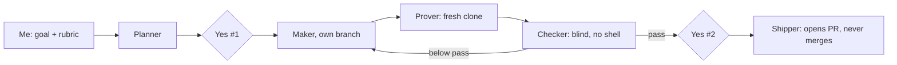

# Agent loop that checks itself: finished

**How I know it works:** the builder agent called cycle 1 done. A second agent that never saw the builder's notes scored it **4.33 out of 5** and found four gaps. After the fixes it scored **4.67**. Each cycle, a fresh clone ran every command in the guide, in 3 to 4 seconds.

Built with: Claude Code subagents, git worktrees, GitHub CLI

**The problem:** the agent that writes something grades it too kindly. "It works" from the builder isn't proof.

**What I built**
1. I wrote the goal and a three-line rubric a stranger could score: runs as written, no hidden prerequisites, the scoring step is learnable.
2. A Planner agent wrote the plan and 13 questions attacking it. I answered them and approved the plan (yes #1).
3. A Maker agent built in its own branch. A Prover agent followed the guide in a fresh clone and pasted the real output.
4. I re-ran the gate myself. A Checker agent with no shell, on a different model, scored each line with file and line evidence.
5. I approved the ship separately (yes #2). The loop opened a pull request and didn't merge it.

**The map**

**What the Checker caught that the builder missed**
- The same page was reported at two sizes (45,444 vs 45,426) with no explanation. The fix traced it to 18 Windows line endings.
- Two normal outputs looked like failures: pip's upgrade notice, and `grep -c` exiting 1 on a zero count.
- A worked example skipped three tools without saying out-of-scope tools aren't scored.

**What broke:** the planning step found a contradiction in my own rules. A LinkedIn verification record counted as wrong evidence, but a Klaviyo one counted toward a miss. The rule I wrote to fix it: a verification record proves an account with that vendor, never a tag on the page.

**What I'd do with more time:** run the official loop-engineer plugin. I used my own version because its tools (Bun, no-mistakes, tasks-axi, treehouse) weren't installed. Run times and cost weren't measured.

**Try it:** [the run record](https://github.com/Trav54219/gtm-engineering-portfolio/tree/main/projects/05-agent-loop) and [the pull request](https://github.com/Trav54219/gtm-engineering-portfolio/pull/1).
