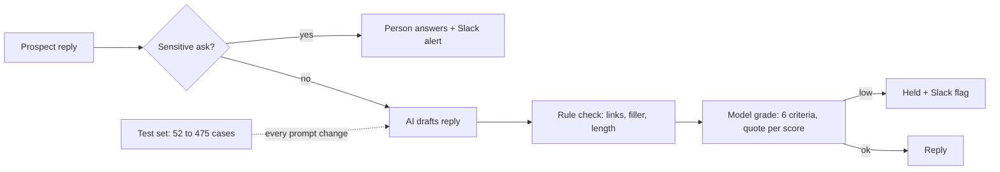

# Grading an AI inbox before it talks to prospects: running

**How I know it works:** every prompt change runs through a test set of prospect replies before it ships, and every draft gets a 1 to 5 score on six criteria with a quote from the draft behind each score. The set started at 52 cases on September 26 and holds 475 today. In production that is **1,351 graded drafts**: 1,333 from test runs and 18 from live replies. When the same 52 cases ran through two models, DeepSeek V4 Pro averaged **4.68** and Claude Opus 5 averaged **4.28**.

Built with: TypeScript, Convex, DeepSeek V4 Pro and Claude Opus 5, Slack

**The problem:** the portal drafts replies to prospects who answered a cold email. A bad reply costs a lead that was already won once: it invents a price, pushes someone who said no, sends a booking link we don't use, or answers a question a person should answer. Reading every draft by hand doesn't scale, and an AI that grades its own writing tends to pass it.

**What I built**
1. A test set of prospect replies. Each case has the move a strong inbox manager would make, a model answer, and must-do and must-not-do rules. The first 52 came from inbox playbooks. Later cases came from real threads and from edge cases I wrote after a run found a weak spot.
2. A grader that scores each draft on six criteria: answers first, a specific next step, listening, brevity, a human voice, and grounded (every price, result and promise backed by the offer). Every score must quote the draft. A grade without evidence is refused, not guessed.
3. A rule-based check next to the model grader. Exclamation marks, "just following up", stock openers, leftover placeholders, booking links and replies over six sentences are caught by patterns a model can't be talked out of.
4. A safety layer that keeps the AI out of ten kinds of asks: controlled substances, license numbers, identity and address checks, legal threats, prompt injection, press and acquirers, job seekers, data deletion, repeat complaints and competitors. Those go to a person with a Slack alert.
5. A live grade on replies that went out, with a Slack flag when one scores low.

| Run | Drafts graded | Average | Drafts with a criterion at 2 or below |
|---|---|---|---|
| Sep 26, first 52 cases, Claude Opus 5 | 90 | 4.26 | 26 |
| Sep 26, same cases, DeepSeek V4 Pro | 212 | 4.68 | 22 |
| Oct 8, Claude Opus 5 | 104 | 4.29 | 30 |
| Oct 18, set grows to 88 cases with real threads, DeepSeek V4 Pro | 367 | 4.78 | 31 |
| Oct 25, 117 new edge cases added, DeepSeek V4 Pro | 522 | 4.23 | 167 |
| Safety routing cases, Oct 18 to 25 | 32 | 5.00 | 0 |
| Live replies, Sep 30 to Oct 9 | 18 | 4.21 | 7 |

By criterion, Claude Opus 5 was weakest on voice (3.98) and grounded (4.08). DeepSeek V4 Pro was weakest on listening (4.28) and answers first (4.35).

**The map**

**What broke**
- On October 25 I added 117 harder cases: requests to hold, escalations, logistics questions, follow-ups and messy replies. The average fell from 4.78 to 4.23 and 167 drafts had at least one criterion at 2 or below. Three fixes followed the same day: a draft guard, more asks routed to a person, and corrected price cases. The low run is the reason the set exists.
- Real threads showed failures no playbook case had. One reply promised contract terms. One told a prospect a group was waiting when none was confirmed. One put a call on the calendar before the prospect agreed to a time. Each became a rule and a test case.
- The grader marked a prospect's own name as invented because it didn't know who the reply went to. It now gets the prospect's name and company from our records.
- 160 runs failed, 146 of them because the drafting model errored. Those count as failures in the data, never as passes.

**What I'd do with more time:** tie grades to outcomes. The scores measure reply quality, not booked calls, and 18 live grades is too few to show that a higher score books more. The 270 cases added on October 26 haven't been graded in production yet.

**Try it:** the code is in a private repo, so this page shows the method and the numbers rather than the code.
