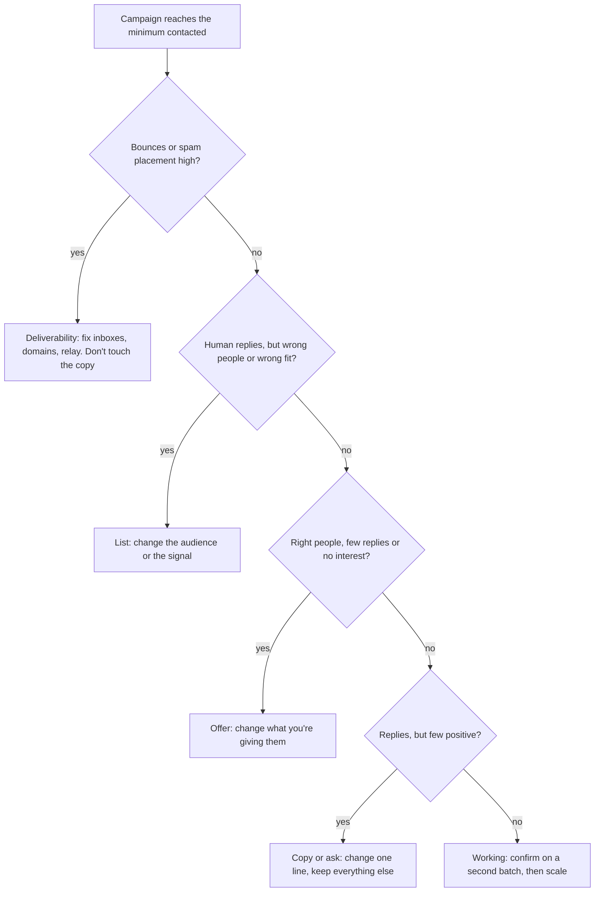

# Campaign scorecard, checklist and the math

This is the scorecard I fill in for every outbound campaign, the checklists I run before and after launch, and how I decide whether to keep, change or stop a campaign. It's generic on purpose, so any team can copy it. My own filled-in results, misses included, are on the [campaign scoreboard](https://github.com/Trav54219/gtm-engineering-portfolio/blob/main/campaigns/scoreboard.md). The thinking behind it is in [my philosophy on go-to-market](gtm-philosophy.md).

**The rules the whole page rests on**

- The denominator is **contacted leads**: people whose first email went out at least 48 hours ago. Never replies, never sends.
- **Machine replies are not replies.** Out-of-office, left-the-company, wrong-person and autoresponders get their own column and never go in a numerator.
- **One change per test**, or the result can't be traced to anything.
- **No verdict below the minimum.** My default is 2,000 contacted before a campaign gets called a keep or a kill.
- **Diagnose in order:** deliverability, then list, then offer, then copy.

## 1. The scorecard

One row per campaign. Fill in the top half before launch and the bottom half as results come in.

**Before launch**

| Field | What goes in it |
|---|---|
| Campaign | Name and the one thing this test changes from the last one |
| Signal | Why this account, why now (job post, funding, bid, new leader, expansion) |
| Audience | Industry, company size and the title emailed |
| Offer | The first yes being asked for, in one line |
| Pool size | How many companies exist in this market, counted before any spend |
| List cost | Data and verification spend for this list |
| Stop rule | The numbers that end the test, written before it starts |

**After launch**

| Metric | How it's counted |
|---|---|
| Contacted | Leads whose email 1 went out 48+ hours ago |
| Bounce rate | Bounces ÷ emails sent |
| Machine replies | Out-of-office, left company, wrong person, autoresponders |
| Human replies | All replies minus machine replies |
| Reply rate | Human replies ÷ (contacted − out-of-office) |
| Positive replies | Interested, asked for info, or asked to meet |
| Positive rate | Positive replies ÷ contacted |
| Positive share | Positive replies ÷ human replies |
| Meetings | Meetings held, not booked |
| Pipeline | Value of opportunities created |
| Cost per positive reply | (Data + verification + sending infrastructure + tools) ÷ positive replies |
| Verdict | Too early, keep, change one thing, kill, or scale |
| Next test | The one thing that changes next |

The same columns as a header row you can paste into a sheet:

```
campaign,changed,signal,audience,offer,pool_size,list_cost,stop_rule,contacted,emails_sent,bounces,machine_replies,human_replies,positive_replies,meetings_held,pipeline,total_cost,verdict,next_test
```

## 2. Before launch: the checklist

**Infrastructure**

- [ ] Every sending domain passes MX, SPF, DKIM and DMARC ([domain health tool](https://www.breezygrowthco.com/tools/domain-health))
- [ ] Inboxes warmed at least 14 days, reputation read the same day as launch
- [ ] The relay or host every inbox sends through is checked, not just the domains
- [ ] Daily cold volume planned from inbox capacity (40 a day per inbox, warm-up included)
- [ ] Open tracking off, plain text, no images

**List**

- [ ] Market counted for free first: big enough to reach the minimum contacted
- [ ] Company filter (size, industry, already contacted, current customers) passed before any paid step
- [ ] The right person for the company size (owner, head of the function, or a director)
- [ ] Every email verified; catch-alls in their own campaign
- [ ] Emails on the company's own domain only
- [ ] Fit check against each company's own website
- [ ] Names cleaned: no SHOUTING CAPS, no "LLC" in a first line ([lead name cleaner](https://www.breezygrowthco.com/tools/lead-name-cleaner))
- [ ] Duplicates, past contacts and unsubscribes removed ([lead list scrubber](https://www.breezygrowthco.com/tools/lead-list-scrubber))

**Copy**

- [ ] The offer is checked before the copy is written
- [ ] 30 to 75 words, one question, the same ask across every variant
- [ ] Every spintax combination printed and read by a person
- [ ] Every fact about the prospect checked against their own site
- [ ] No spam phrases, no AI tells ([cold email checker](https://www.breezygrowthco.com/tools/cold-email-checker))
- [ ] The sequence stops on a reply

**Launch**

- [ ] Stop rule and the one variable being tested are written on the scorecard
- [ ] Leads added only while the campaign is paused
- [ ] A preflight pass under 12 hours old, with a test email to a real inbox
- [ ] Start at a low daily cap and ramp

## 3. After launch: the checklist

**First 48 hours**

- [ ] Bounce rate under 3%. Autopause at 10%.
- [ ] Test email and a sample of sends landed in the inbox, not spam
- [ ] No duplicate sends to the same person

**First week**

- [ ] Replies sorted into human and machine
- [ ] Every human reply answered the same business day
- [ ] Inbox reputation still holding

**At the minimum contacted**

- [ ] Rates calculated on contacted leads
- [ ] Verdict written on the scorecard
- [ ] The next test picked: one change only

## 4. How I decide what to do next



The same thing as a table:

| What you see | What it usually means | What changes next |
|---|---|---|
| Bounce rate over 3%, or a 10% autopause | Bad data or catch-alls mixed in | Re-verify, split catch-alls, check the source |
| Spam placement up, replies at zero across campaigns | Deliverability, not the campaign | Fix inboxes and the relay before judging anything |
| Most replies are machine or wrong person | The list is wrong | Change the audience or the title, keep the copy |
| Right people, almost no replies | The offer isn't worth answering | Change the offer, keep the list |
| Plenty of replies, few positive | The ask is too big or unclear | Smaller first yes, one line changed |
| Positive replies, few meetings held | Follow-up or qualification | Faster replies, clearer next step |
| Holds on a second batch of the same signal | It works | Add volume on the same signal, offer and audience |

**My default stop rule** (the [kill gate](https://github.com/Trav54219/gtm-engineering-portfolio/blob/main/guards/kill_gate.py)): once 2,000 leads are contacted, a campaign is flagged when the reply rate is under 1% or fewer than 5% of replies are positive. It flags only. A person makes the call, because a flag can't see a meeting that's about to happen.

## 5. The math

**Why a minimum before any verdict.** Small samples can't tell a good campaign from a bad one. Here are three results, each shown with the range the true rate could sit in (95% confidence):

| Result | Rate seen | The true rate could be anywhere from |
|---|---|---|
| 2 replies from 200 contacted | 1.0% | 0.27% to 3.57% |
| 20 replies from 2,000 contacted | 1.0% | 0.65% to 1.54% |
| 0 positives from 300 contacted | 0% | 0% to 1.26% |

At 200 contacted, a 1% campaign could really be a 0.3% campaign or a 3.5% one. At 2,000 the range is narrow enough to act on. And zero positives from 300 doesn't prove the offer is dead: it could still be running at 1%.

**Rule of three.** If nothing has happened after n contacted, the true rate could still be as high as about 3 ÷ n. Zero positives from 300 contacted means it could be up to 1%.

**Is variant B really better?** Use an exact test on the two counts, not a gut read of the percentages.

| Test | A | B | Exact test (p) | Call |
|---|---|---|---|---|
| 500 each | 6 positive (1.2%) | 12 positive (2.4%) | 0.23 | Not proven. B doubled A and it can still be noise |
| 1,000 each | 10 positive (1.0%) | 25 positive (2.5%) | 0.016 | B wins |

The [reply rate checker](https://www.breezygrowthco.com/tools/reply-rate-checker) runs this test, and takes out machine replies first.

**Working backwards from a goal.** Start from the meetings the business needs, not from how many emails you can send. With example numbers (put in your own):

| Step | Example |
|---|---|
| Meetings needed a month | 10 |
| Share of positive replies that turn into a meeting | 50% → 20 positive replies |
| Positive rate on contacted | 0.5% → 4,000 contacted a month |
| Emails per contact in the sequence | 3 → 12,000 sends a month |
| Cold sends per inbox (10 a day × 21 sending days) | 210 → 58 inboxes |
| Inboxes per domain | 3 → 20 domains, plus spares |

The inbox number comes from 40 sends a day per inbox at a 3:1 warm-up to cold ratio: 30 warm-up, 10 cold. Size the list first. If the market only has 1,500 companies with the signal, it can't supply 4,000 contacted a month, and buying 58 inboxes won't change that.

**Cost per positive reply.** Everything the campaign spent, divided by what it produced:

> (data + verification + sending infrastructure + tools) ÷ positive replies

For example, $600 of data and verification, $400 of infrastructure and $300 of tools for a month that produced 20 positive replies is $65 a positive reply. That's the number to compare campaigns on, and the one to set against what a customer is worth.
