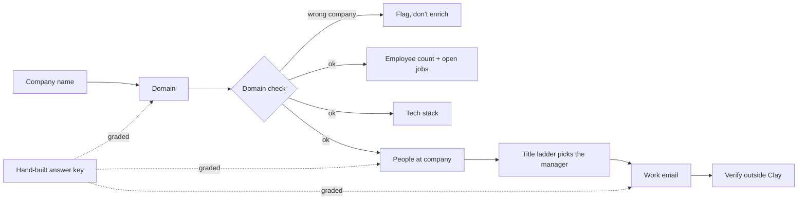

# A Clay table graded against my own research: finished

**How I know it works:** I built a Clay table of 15 companies I'm applying to and graded every column against an answer key I had already built by hand: the right domain, the hiring manager and a BounceBan-verified email for each. Clay's work email matched my verified address at **14 of 15** companies, and the 15th was also deliverable on the company's second mail domain. Clay's domain lookup from the company name was right at **11 of 15**, and all four misses were a different company with the same name.

Built with: Clay functions through the Clay CLI, Python, BounceBan

**The problem:** a GTM table is only as good as its first column. If the domain is wrong, every column after it enriches the wrong company, and nothing in the table looks broken. I had already hit this by hand: a job board listed contacts for Strella Biotechnology under Strella, a different company.

**What I built**
1. A table of 15 companies hiring GTM engineers, starting from the company name only, the way a job-board feed arrives.
2. Six Clay function columns run through the API: domain, employee count, open jobs, website tech stack, people at the company, and work email. Each one was cost-tested on one row before running all 15.
3. A grader that compares each column to the hand-built answer key and prints totals only, since the key holds real people's names and emails.

| Column | Clay credits per row | Result on 15 companies |
|---|---|---|
| Domain from company name | 1 | 11 right, 4 were a different company with the same name |
| Work email for the hiring manager | 3 | 14 identical to my verified address, 1 deliverable on a second mail domain |
| People at company, no title filter | 1 | The manager I picked was in the returned list at 4 |
| Website tech stack | 2 | HubSpot on 11 homepages, Salesforce on 9, both on 6 |
| Employee count and open jobs | 1 each | Filled on all 15 |

Total spend: 144 of the workspace's 200 free credits.

**The map**

**What broke**
- The domain lookup returned siroclinpharm.com for Siro, hearthdisplay.com for Hearth, strellabiotech.com for Strella and basis.com for Basis. A name alone picks whichever company owns it. The table needs a domain check right after this column that compares the result to the job post's apply link or the company's LinkedIn website, and stops the row when they disagree.
- Without a title filter the people search returns 10 people, and the manager I had picked by reading each job post was among them at only 4 of 15 companies, including the two smallest. The people column needs the same title ladder I use by hand: the founder under 50 people, the head of the function from 51 to 500, a director above that.
- A homepage scan saw HubSpot and Salesforce on the same site at 6 companies. Marketing scripts on a website don't say which CRM the sales team actually works in, so the tech stack column can't decide that alone.

**What I'd do with more time:** run the domain check and the title ladder as real columns and re-grade, then move the table into the Clay UI with a webhook source so new job posts arrive on their own. Webhook sources need a paid Clay plan.

**Try it:** [the project](https://github.com/Trav54219/gtm-engineering-portfolio/tree/main/projects/09-clay-company-research) has the table schema, the run script and the grader. The answer key and raw outputs hold real people's contact details, so they stay private.
