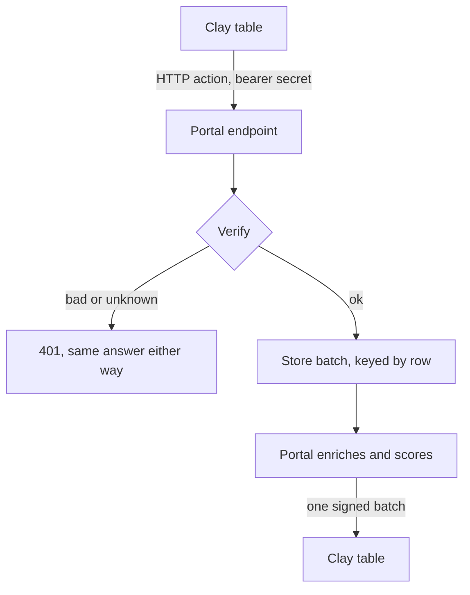

# Clay in production

How I use Clay, the part of it that runs in production code, how I grade it before trusting it, and how I'd run a company's Clay foundation if I owned it end to end. The first two sections are work I've shipped. The last two are how I'd run it, and they're labelled that way.

**At a glance**

- A two-way bridge between Clay tables and a production client portal: Clay posts rows in, the portal enriches and scores them, and sends them back as one signed batch
- Every Clay column graded against a hand-built answer key before trusting it: work email matched on 14 of 15 companies, domain from company name on 11 of 15
- Credits tracked per row and per column: every column cost-tested on one row before running the table

## 1. The two-way bridge

Clients and staff already enrich in Clay tables, so the portal I built meets them there. A Clay table can push rows into the portal, and the portal sends them back after it enriches and scores them.

What makes it safe to run:

- **Clay's HTTP action can set a header but can't sign a request**, so the bridge takes either a bearer secret or a Standard Webhooks signature over the raw body for senders that can sign.
- **Every row has a key.** The key is the table's key field, else an id column, else a stable hash of the row. The same row sent twice is one row, so a retried POST from Clay is harmless and never double-counts.
- **Batches are capped at 500 rows**, and the enriched rows go back as one batch, keyed so Clay matches each one to its original row.
- **A failed send back to Clay stays retryable**, and the response is never stored.
- **A wrong secret and an unknown connection get the same 401**, so nobody can probe for valid connections. Secrets are compared in constant time and encrypted at rest.
- **The outbound table URL must be public and https.** Private addresses are refused, and clients can't create or change connections themselves.

The tests run a 20-row round trip (in, enrich, out, sent twice to prove it's idempotent), plus the wrong-secret, failed-send and private-URL cases. The rest of the system around it is on [how the client portal is built](portal-architecture.md).

## 2. Graded before trusted

A Clay table is only as good as its first column. If the domain is wrong, every column after it enriches the wrong company, and nothing in the table looks broken. So before relying on Clay for research, I built a table of 15 companies, ran six Clay functions on it, and graded every column against an answer key I'd built by hand. The full write-up is [a Clay table graded against my own research](clay-company-research.md).

| Column | Credits per row | Result on 15 companies |
|---|---|---|
| Domain from company name | 1 | 11 right, 4 were a different company with the same name |
| Work email for the hiring manager | 3 | 14 identical to my verified address, 1 deliverable on a second domain |
| People at company, no title filter | 1 | The right manager was in the list at only 4 |
| Website tech stack | 2 | HubSpot on 11 homepages, Salesforce on 9, both on 6 |
| Employee count and open jobs | 1 each | Filled on all 15 |

Total: 144 credits. What it changed: a domain check now has to sit right after the domain column and stop the row when it disagrees with a second source, and the people column needs a title ladder (founder under 50 people, head of the function from 51 to 500, a director above that).

## 3. How I'd run a company's Clay foundation

*This is how I'd run it, built from the rules above and the rest of my data stack. It isn't a description of an existing deployment.*

**Table design**

- **One input table per source** (job posts, inbound forms, CRM exports, event lists), all feeding one scoring table, so a source can be turned off without touching the rest.
- **Domain first, then a domain check.** Nothing paid runs on a row until its domain is confirmed against a second source.
- **Conditional columns.** A paid column only runs when the columns before it passed: right company, inside the ICP, not already a customer, not already in the CRM with an owner.
- **Waterfalls ordered by cost.** The cheapest provider that finds as much as the best one goes first, and the waterfall stops at the first verified answer.
- **A dedupe key on every table**, the same way the bridge keys rows, so a re-run doesn't re-enrich or re-push.

**Writing back to the CRM**

- **Match by domain or an external id, never by name.** Upsert, so a repeat signal refreshes the account instead of creating a duplicate.
- **Every write is logged** with what changed and which table changed it, so a bad bulk update can be found and reversed.
- **Owner and reason travel with the record.** A score lands with the arithmetic behind it and the signal that triggered it.

## 4. Credits

*Same label: these are the rules I'd apply to Clay credits, taken from how I already run paid data.*

- **Cost-test on one row before running a column on a table.** I did this on every column in the graded table above.
- **Track credits per row and per column**, then cost per qualified account per table, every week. A table that burns credits without producing accounts gets fixed or turned off.
- **Free filters before paid columns.** Company size, industry and already-contacted checks cost nothing, so they run first.
- **Never pay twice.** Dedupe keys and auto-run limits stop a re-run from re-enriching rows that already have an answer.
- **A monthly cap per table**, with an alert before it's hit, not after.
- **Build vs. buy per column.** If a free source or an existing vendor key answers the same question as well, the Clay column goes.

**What I'd check first in an existing workspace**

- [ ] Which tables run automatically, what feeds them, and what each one costs a month
- [ ] Whether the domain column is checked before paid enrichment runs
- [ ] Duplicate rows and duplicate enrichments across tables
- [ ] Which columns' outputs anyone actually uses in the CRM or in sequences
- [ ] How rows reach the CRM: match key, owner assignment, and what happens on a conflict
- [ ] Which tables have no owner
