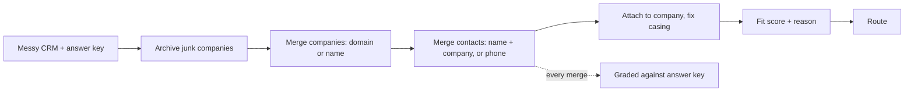

# CRM cleanup, scoring and routing in HubSpot: finished

**How I know it works:** I built a messy CRM with an answer key first, then let the cleanup loose on it in a live HubSpot account. **48 merges, 48 right, 0 wrong.** That includes 6 decoys: different people with the same name at different companies, and none of them were merged. A second run finds nothing to do.

Built with: Python, HubSpot CRM API (batch, merge and associations v4), custom properties

**The problem:** a sales team can't trust a CRM where one company shows up three times, one buyer shows up twice, and half the names are in all caps. Reps then pick leads by gut, because nothing says who is worth a call.

**What I built**
1. A seeder that loads 98 companies and 316 contacts into HubSpot, with the duplicates, orphans and broken names real CRMs have, plus an answer key for every record.
2. A cleanup that merges companies on domain or normalized name, then merges contacts on name plus company or a shared phone, and attaches contacts to their company.
3. A fit score from 0 to 100 written onto every contact, with the arithmetic in a second field so a rep can see why.
4. A route on every contact: AE Enterprise, AE Mid-market, SDR or Nurture.
5. An audit that runs before and after and grades every merge against the answer key.

| | Before | After |
|---|---|---|
| Company records | 98 | 80 |
| Companies with a duplicate | 18 | 0 |
| Contact records | 316 | 286 |
| People with a duplicate | 30 | 0 |
| Contacts with no company | 40 | 8 |
| Broken name casing | 86 | 0 |
| Scored and routed | 0 | 286 |

**The map**

**What broke**
- HubSpot's default auto-association attached all 60 orphan contacts by email domain before my code ran. The useful check in a real portal is the contacts HubSpot couldn't match: a personal email with a typed company name, or a shared phone.
- HubSpot created 3 junk companies from personal-email domains it didn't recognize and attached contacts to them. The cleanup now archives any company on a personal-email domain.
- Contacts can only be matched to a company after the company duplicates are gone, so the dry run undercounts contact merges and prints a warning saying so.

**What I'd do with more time:** fit the score weights to closed-won deals instead of my own judgment, and map each route to a round-robin list of owners.

**Try it:** [the project](https://github.com/Trav54219/gtm-engineering-portfolio/tree/main/projects/06-crm-cleanup). Six commands rebuild the mess, clean it and grade it in a free HubSpot account.
