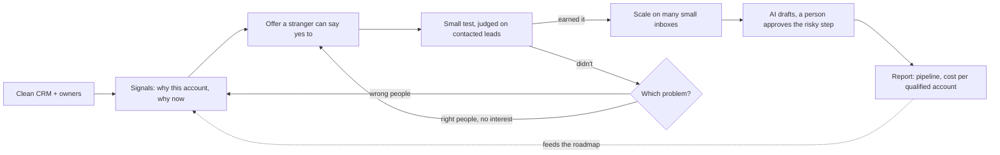

# My philosophy on go-to-market

[How I build outbound from scratch](outbound-from-scratch.md) is the order I set a system up in. This page is why: what I believe about go-to-market systems, from the CRM and the data underneath it to offers, signals, testing, sending, AI and how results get measured. Each belief comes from running GTM for B2B clients at Breezy Growth, and most of them come from something that went wrong first.

**The short version**

1. GTM engineering is a product. Sales, Marketing, Customer Success and RevOps are its customers.
2. The CRM is the foundation. Automation on dirty data just makes mistakes faster.
3. The offer decides the result more than the list or the copy.
4. Timing beats targeting. Every play starts from a signal that says why this account, why now.
5. Test small and judge on contacted leads. Volume goes only to what earned it.
6. Volume comes from many small inboxes, never a few big ones.
7. Contacts before inboxes. Capacity with nothing to send is just a bill.
8. Spend like it's my money: price-check, test on 10 rows, cache, cap.
9. AI does the work and a person owns the risk. Every agent gets graded before it touches a customer.
10. Measure what the business pays for: pipeline and cost per qualified account, never activity.
11. Rules live in code that blocks the action, not in anyone's memory.

## 1. GTM engineering is a product

The systems I build have users: reps, marketers, CS managers, RevOps, and at Breezy Growth, clients. If they don't use it, it doesn't matter how well it's built.

- **Start with the friction, not the tool.** I'd rather spend the first weeks sitting in on calls and asking each team what wastes their time than pick a stack first. The roadmap is their list of friction, ranked by what it costs.
- **Every use case has an owner team and a number it should move.** A signal feed exists to raise meetings per rep. A dedupe exists so routing and reporting can be trusted. If I can't name the number, it doesn't go on the roadmap yet.
- **Ship small, in production, early.** One quick win that reps feel the same week buys the trust to build the bigger foundation.
- **Built so people can rely on it without me.** Documentation, monitoring and tests are part of shipping. That's why the client portal has an [architecture write-up](portal-architecture.md): someone other than me should be able to see how it works and what breaks when.
- **Adoption is the finish line.** A workflow nobody opens is a cost. I'd rather ship three things a team uses daily than ten they were shown once.

## 2. The CRM is the foundation

Every signal, score and route ends up as a record someone acts on. If the records are wrong, every system on top of them is wrong faster.

- **Clean before you automate.** On a messy HubSpot CRM I deduplicated, scored and routed every contact, and graded every merge against an answer key: [48 of 48 merges right, 0 wrong](crm-cleanup.md), with same-name decoys left alone. A merge that's wrong is worse than a duplicate, so the answer key comes first.
- **Upsert by domain, never insert blind.** My [signal to CRM](signal-to-crm.md) job writes companies by domain, so a company that posts a second job gets a fresher signal on the same record instead of a duplicate.
- **Every record has an owner and a reason.** A score with no explanation gets ignored. Each account my systems create carries the arithmetic behind its score, the route, the title to contact and the signal that put it there.
- **Hygiene runs on a schedule.** A cleanup done once a year is out of date by spring. Dedupe, ownership and field checks should run like any other job.

## 3. The offer decides the result

Cold traffic doesn't know you, doesn't trust you and wasn't looking for you. Better copy can't fix that. What fixes it is giving them something concrete enough to say yes to without a meeting.

On my own campaigns, when the first email offered something specific (a named building that needed a cleaner, an open public bid with a deadline), 0.77% of the companies contacted answered with interest. When it offered a service, 0.25%. The markets differed too, so it isn't a clean test, but the offer was the biggest change between them.

So the order I work in is:

- **Who it's for and what they'd call the outcome**, in their words, not ours.
- **A small first yes.** A reply of a few words, not a 30-minute call with a stranger.
- **Belief before price.** Proof from their own world first. The price comes up on the call.
- **The offer gets checked before anyone writes copy.** When replies stop, I look at the offer before I rewrite a line.

## 4. Timing beats targeting

The inboxes I send to are numb. Owners and VPs get the same "quick question" email over and over. A list pulled from industry and headcount alone gives them no reason to read past the first line.

So every play starts from something public that makes the outreach timely: a job post for the role the offer replaces, a funding round, a public bid, a contract about to end, a new location, a new leader. The signal decides who goes on the list, and it gives the first line something true to say. It also keeps lists small, which is the point: fewer companies, each with a reason.

Signals aren't only for new logos. The same thinking covers the whole customer lifecycle:

- **Before the sale:** hiring for the role you replace, funding, tech stack changes, new leadership, open bids. My signal job turned [20 new SDR and BDR job posts into 18 scored HubSpot accounts](signal-to-crm.md) on its first run, and the 5 companies the seller doesn't sell to scored 0 and went to nurture instead of a rep's queue.
- **Inside current customers:** new teams, headcount growth and new locations are expansion signals.
- **Before a renewal:** a champion leaving, a usage drop or a run of support tickets is a risk signal that should reach the account owner before the renewal call, not after.
- **After someone leaves:** a past champion who lands at a new company is the warmest lead there is.

I also sell the outcome, not the mechanism. Nobody cares how many inboxes or which enrichment tool. They care about the result and how long it takes.

## 5. Test small, then earn volume

A new market or angle starts as a test, never a launch:

- **Count the market first, for free.** If the whole market is 13 firms, a test can't reach a verdict, and no amount of copy changes that.
- **A 10-lead preview before a full list.** Ten real leads and the copy go to the client before any money goes into scraping and verifying hundreds. If the angle is wrong, we find out for the cost of ten rows.
- **One change at a time.** Every variant keeps the same ask, so a test measures the line that changed.
- **Rates on contacted leads, never on replies.** Autoresponders and departed employees reply too. One campaign had 8 replies from 576 sends and none of them were from a person.
- **No verdict on noise.** There's a minimum number of contacted leads before I call anything, and an A/B winner has to pass an exact test.

Most tests lose, and that's fine as long as they're cheap and the loss is recorded. My own campaigns are on a [public scoreboard](https://github.com/Trav54219/gtm-engineering-portfolio/blob/main/campaigns/scoreboard.md), misses included: 13 campaigns, 926 contacted, 7 raw replies. The HVAC owner campaign that sent about 2,000 emails to 717 owners and got 19 replies, all machine or wrong person, taught me more than a win would have. Deliverability had passed, so the list was the problem, and the next campaign changed the audience instead of the wording.

When something does work, it gets volume: more of the same signal, the same offer and the same audience, on more inboxes.

The scorecard, the checklists and the math behind each of these calls are on [campaign scorecard, checklist and the math](campaign-scorecard.md).

## 6. Volume comes from many small inboxes

I'd rather send 10 cold emails a day from each of 225 inboxes than 200 a day from a dozen.

- **Each inbox is rated at 40 emails a day, warm-up included.** At a 3:1 warm-up to cold ratio that's 10 cold and 30 warm-up per inbox. I plan volume from that number, not from what the sequencer allows.
- **A few inboxes per domain, many domains.** The fleet runs 225 inboxes across 75 domains. Reputation is earned per inbox and per domain, so when one gets flagged, the campaign loses a small slice of its capacity instead of all of it.
- **Generic domains, never the company's brand.** A burned sending domain shouldn't take the real company email down with it.
- **A domain stays on its campaign until the campaign ends.** Rotating mid-campaign throws away the reputation the inbox earned and breaks reply threads.
- **Warm-up is measured, not assumed.** Raising the warm-up reply rate from 30% to 40% cut spam placement from 33.9% to 12.2%, while a control group left alone didn't move.

Spreading out has a limit I learned the hard way. Every inbox in the fleet sent through one shared relay, and when that relay landed on Spamhaus, 75 domains didn't help. That's the [deliverability incident](deliverability-incident.md): 309 accounts replaced and 37 campaigns re-attached with zero mismatches. Now I check the relay, not just the domains.

## 7. Contacts before inboxes

Sending capacity is easy to buy. Leads worth emailing aren't. At one point the fleet could carry far more email than we had verified, on-target contacts to send, and every unused inbox still cost money and still needed warming.

So the fleet gets sized to the list, not to the size of the market. When lead supply is the constraint, I take the slower 3:1 warm-up ratio, because spare send capacity is worth less than inbox reputation.

## 8. Spend like it's my money

Data and enrichment spend grows quietly. One list re-run, one retry loop on paid credits, one provider that charges per call instead of per result, and the bill doubles without anyone deciding it should.

- **Price sweep before a new job.** I check every provider for the job, read the unit (per call, per result and per success aren't the same price), and test the two or three cheapest on 10 real rows. The cheapest one that finds as much as the best one wins.
- **Own keys first.** Paid fallback credits are used only when our own vendor key fails, and a mistake in my parameters is never retried on paid credits.
- **Every paid call is cached and tagged.** Re-running a list after an ICP change shouldn't pay twice, and every call carries the job it belongs to, so I can say what a list cost. Failures and account balances are never cached.
- **Paid lookups need evidence.** One early run made 46 paid email lookups and 20 had to be dropped, 7 of them for the wrong person. Now a paid lookup needs a source page naming the person.
- **Free first, paid on what's left.** I found the CRM behind [276 of 289 growing companies](tech-stack-segment.md) and built the segments for $0.09, and pulled 449 job postings for my own job search for about 5 cents.

Build versus buy follows the same logic. I buy commodity data and sending. I build the glue and the judgment: scoring, routing, guards and the checks that decide what's worth paying for.

## 9. AI does the work, a person owns the risk

I use AI agents every day, to research accounts, check fit against a company's own website, draft replies and write code. I don't trust any of them until they've been graded.

- **An AI that grades its own work passes it.** So my replies are graded by a separate grader against a test set of real prospect replies. That set grew from 52 cases to 475, and [1,351 drafts](ai-inbox-eval.md) have been scored on six criteria, with a quote from the draft behind every score.
- **Rules a model can't be talked out of.** Next to the model grader, a pattern check catches booking links, filler, leftover placeholders and replies that run too long.
- **Risky asks go to a person.** Ten kinds of questions (legal threats, data deletion, identity checks, press, competitors and more) never get an AI answer. They go to a person with a Slack alert.
- **The same rule applies to code.** One agent builds and a second grades it blind against a written rubric. On the [first run](agent-loop.md) the checker found 4 gaps the builder missed, and the score went from 4.33 to 4.67 out of 5 after fixes.
- **Check an AI tool before you pay for it at scale.** I ran six Clay functions against an answer key I built by hand before trusting them for research: work email matched on [14 of 15](clay-company-research.md), domain from company name on 11 of 15.

## 10. Measure what the business pays for

Sends, opens and activities are easy to count and easy to inflate. The business pays for pipeline.

- **The numbers I report:** coverage of the target market, conversion at each stage, pipeline created, time saved for the team, and cost per qualified account or per positive reply.
- **The denominator is contacted leads.** Replies from machines and wrong people come out first, in their own column.
- **Misses get reported the same way as wins.** My scoreboard has every campaign on it, including the ones that produced nothing. A report that only shows wins can't tell anyone what to stop doing.
- **One page, every week.** If leadership has to ask how GTM engineering is going, the report failed.

The template I use is the [campaign scorecard](campaign-scorecard.md).

## 11. Rules live in code

Each of these beliefs is enforced somewhere it can't be skipped. A campaign can't start without a fresh preflight pass. Leads can't be added to a campaign that's already sending. Paid verification refuses a company that never passed the free filter. Copy fails on a broken spintax branch or an AI tell. The guards run as hooks on the tool call itself, because a reminder doesn't stop a tired person or a second agent session, and a hook does.

Most of those rules exist because something went wrong once. The step-by-step version, with what each guard caught, is [how I build outbound from scratch](outbound-from-scratch.md), and the [guard code is public](https://github.com/Trav54219/gtm-engineering-portfolio/tree/main/guards).

## How this shows up on a team

- **I write the roadmap and I ship it.** Plans get judged by what's running in production.
- **I explain tradeoffs in plain words.** A sales leader should know what a system costs, what it can get wrong, and what happens when it does, without reading code.
- **I write things down.** Every project I've built has a write-up with how the number was measured, which is why this portfolio exists.
- **I say what didn't work.** The [deliverability incident](deliverability-incident.md) and the scoreboard misses are public on purpose.
