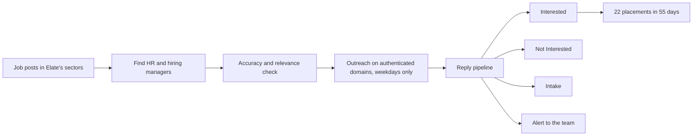

# Job-post signal outbound for a recruitment agency: finished

**Result:** **22 placements in 55 days** for Elate Staffing Solutions, a UK recruitment agency. That beat the target we started with. Lead conversion rose **50%** over their manual process, and reply handling went from days to hours.

Client: Elate Staffing Solutions Ltd. (industrial, technical, engineering and commercial recruitment, UK)

**The problem:** Elate sells to HR managers and hiring managers. Their prospecting was manual: someone found contacts by hand, qualification changed from person to person, and a reply could sit for days before anyone answered it. A recruitment agency's best lead is a company with an open role right now, and by the time a manual process reaches that company, the role is often filled.

**What I built**
1. Automated sourcing of HR managers, hiring managers and decision-makers in Elate's sectors, with accuracy and relevance checks before anyone entered a campaign.
2. A job-post scraper as the trigger. A company that posts a role in Elate's sectors enters outreach while the role is still open.
3. Messages written to the hiring manager's problem with that role, sent at volume on weekdays during working hours.
4. SPF, DKIM and DMARC set up on every sending domain before the first send.
5. One pipeline for every reply, with Interested, Not Interested and Intake stages and an alert on each new response, so a reply reaches a person the same day.

**The map**

**Why it worked**
- The trigger was the open role. Targeting by industry and title alone would have reached the same people with no reason to answer that week.
- Authentication came first. Without SPF, DKIM and DMARC, inbox placement is a guess and the reply numbers mean nothing.
- The pipeline closed the gap after the reply. Conversion rose because interested hiring managers heard back in hours, while the role was still open.

**What these numbers leave out:** the engagement was tracked on placements and conversion. Contacts sent, reply rate and meetings booked weren't part of the write-up, so I don't quote them here.

**What I'd do next time:** log contacted, replied and meeting counts per job-post signal from day one, so the next engagement can show which roles and sectors produce placements, not only the total.
