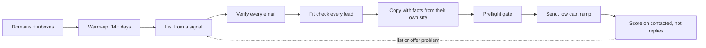

# How I build outbound from scratch

This is the order I set up a cold email program in, and the rule at each step that came from something going wrong. Every number below is from campaigns I ran for my agency and its clients.

Built with: Smartlead, Inframail inboxes on a shared domain pool, Blitz, QuickEnrich, TheirStack and MoltSets for lists, MailTester Ninja for verification, Python guards, Claude agents for fit checks

**The order**

## 1. Domains and inboxes

- Sending domains come from a generic pool, never the client's brand. Clients don't own them, and a domain stays on its campaign until the campaign ends. Rotating domains mid-campaign resets everything the inbox has earned.
- Each inbox is rated at 40 emails a day, warm-up included. I plan cold volume from that number, not from what the sequencer allows.
- New inboxes warm for at least 14 days before any cold send, and a launch gate blocks a campaign that has unwarmed inboxes attached.

## 2. Warm-up settings I measured

- I assumed the fleet ran warm-up and cold email at 1:1. When I measured it, it was 1.75 warm-up sends per cold send. No check had ever looked.
- Raising the warm-up reply rate from 30% to 40% cut warm-up spam placement from 33.9% to 21.3% to 12.2% over three reads, while a control group left at 30% didn't move. That control was later deleted, so I can't repeat the test.
- A 3:1 ratio at 40 a day means 10 cold and 30 warm-up per inbox. I took that trade because lead supply, not send capacity, was what limited us.

## 3. The list

I start from a reason to email: a job post, a funding round, a public bid, or a federal contract about to end. Then I pull the companies and the person.

One build for contract machine shops shows how much a raw pull shrinks:

| Step | Count |
|---|---|
| Owners with a valid email and a real decision-maker title | 409 |
| Rejected by a second, stricter agent reading their website | 105 (26%) |
| Confirmed fits sent to the campaign | 264 |

Across that build, about 5% of the raw people pulled became candidates, and 82% of the domains scored weren't real machine shops. The Blitz title match was loose enough that HR and finance VPs slipped in, so a title filter now runs before every upload.

## 4. Verification

Every address is checked with MailTester Ninja, and only "valid" goes in. Catch-all addresses go in their own campaign: on my scoreboard a catch-all list bounced at 7.9%, against 0.4% for the verified list from the same source. Campaigns autopause at a 10% bounce rate.

## 5. Fit check

An agent checks every lead against its own website before the lead can send. On one live campaign of 106 leads, 66 passed, 19 failed and 21 couldn't be verified. Everything that didn't pass was paused. The failures were mostly companies that had been acquired, the wrong person at the right company, and businesses that weren't the target at all.

## 6. Copy

Plain text, no tracking, and the sequence stops on a reply. If a line mentions a fact about the prospect (a year founded, a certification, a number), a script checks it against the company's own site before it can be used. Leads without a usable fact get a version of the email that doesn't need one.

## 7. The preflight gate

A campaign can't start without a preflight pass from the last 12 hours. Nine guard scripts block a launch, a lead upload or a spend when something is wrong. One stopped a client campaign whose 18 inboxes all read 0% reputation an hour into warm-up, before it burned fresh domains. See [the guard code](https://github.com/Trav54219/gtm-engineering-portfolio/tree/main/guards).

## 8. Measuring it

- Every rate uses contacted as the denominator, never replies. A departed employee's inbox auto-replies every time. One campaign had 576 sends and 8 replies, and none of the 8 were from a person.
- Out-of-office, left-the-company, wrong-person and autoresponder replies go in their own column and never count as replies.
- The number I judge a campaign on is cost per positive reply, and every campaign gets one row on a scoreboard.
- When a campaign fails, I check deliverability first, then the list, then the offer, then the copy. An HVAC owner campaign sent about 2,000 emails to 717 owners, and all 19 categorized replies were machine or wrong-person. Deliverability had passed, so the list was the problem. The next campaign changed the audience, not the wording.

**What I'd do differently:** check the relay host every inbox sends through, not just the sending domains, before uploading a fleet. That's the [deliverability incident](deliverability-incident.md) that stalled launches for three weeks.

**The working files:** [the launch order runbook](https://github.com/Trav54219/gtm-engineering-portfolio/blob/main/runbooks/campaign-launch-order.md), [the campaign scoreboard](https://github.com/Trav54219/gtm-engineering-portfolio/blob/main/campaigns/scoreboard.md) and [the guards](https://github.com/Trav54219/gtm-engineering-portfolio/tree/main/guards).
