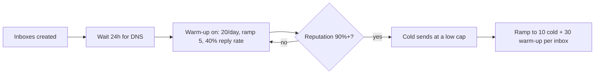
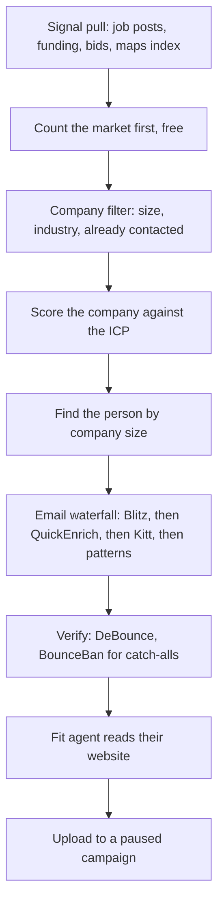
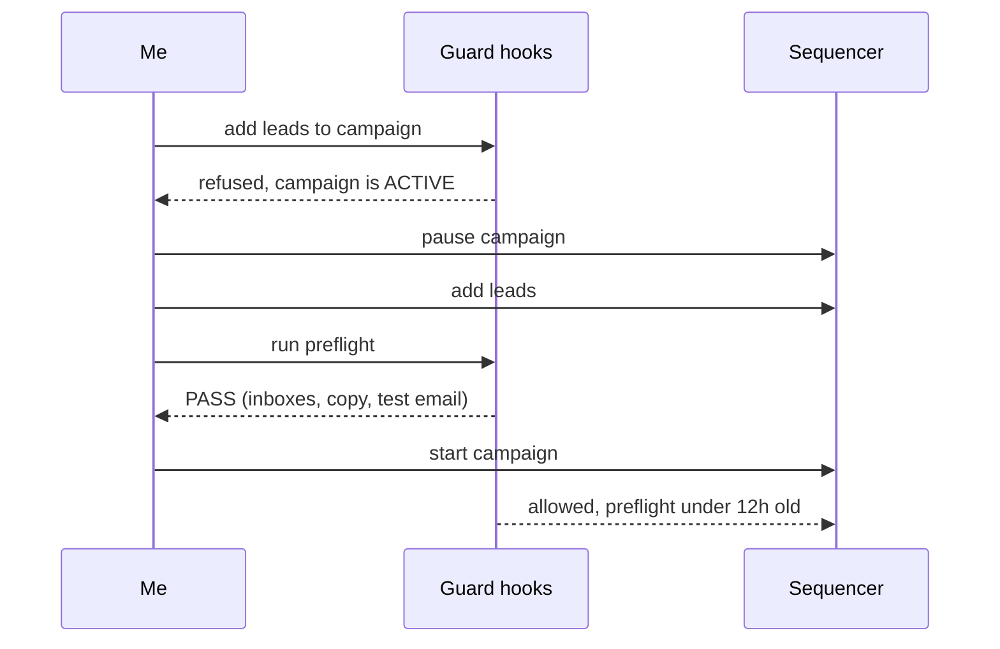
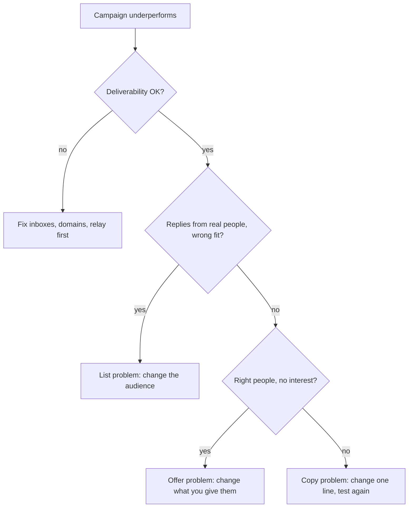

# How I build outbound from scratch

This is the whole cold email system I run for my agency and its clients, in the order I build it: sending infrastructure, warm-up, the list, verification, a fit check on every lead, the copy, the launch gates, replies and how I judge a campaign. Each step has a rule, and most rules exist because something went wrong once. Every number on this page comes from those campaigns.

Built with: Smartlead (PlusVibe added as a second sequencer), Blitz and other providers through treg for lists and emails, a 12.3M-row US business index built from public map data, DeBounce and BounceBan for verification, Python guard scripts that run as Claude Code hooks, Claude agents for fit checks and reply drafts, and a client portal on Next.js and Convex.

**At a glance**

- 225 inboxes on 75 sending domains, each inbox rated at 40 emails a day, warm-up included
- 9 guard scripts that block a launch, an upload or a spend when something is wrong
- Warm-up spam placement cut from 33.9% to 12.2% by changing one setting
- Client results from this system: +$105K for Connect Group and +$85K for Vention in one quarter each, 22 placements in 55 days for Elate Staffing ([sources](client-results.md))

## The whole system

```mermaid
flowchart LR
  subgraph Infra["1. Infrastructure"]
    A[Generic domain pool] --> B[Inboxes + SPF, DKIM, DMARC]
    B --> C[Warm-up 14+ days]
  end
  subgraph List["2. List"]
    D[Signal: job post, funding, bid] --> E[Free company filter]
    E --> F[Find the person]
    F --> G[Find + verify the email]
    G --> H[Fit agent reads their site]
  end
  subgraph Send["3. Send"]
    I[Copy with checked facts] --> J[Preflight gate]
    J --> K[Send at a low cap, ramp]
  end
  subgraph Learn["4. Judge"]
    L[Rates on contacted leads] --> M[Cost per positive reply]
  end
  C --> I
  H --> I
  K --> L
  M -.list or offer problem.-> D
```

## 1. Sending infrastructure

- **Domains come from a generic pool, never the client's brand.** The client doesn't own them, and a domain stays on its campaign until the campaign ends. Rotating domains mid-campaign throws away the reputation the inbox has earned.
- **Every domain gets MX, SPF, DKIM and DMARC checked before it sends.** I built a free tool for that check because I needed it for every new batch: paste the domains, get the exact DNS record to add for anything that fails.
- **Each inbox is rated at 40 emails a day, warm-up included.** I plan cold volume from that number, not from what the sequencer allows.
- **Open tracking off, plain text, no images.** Tracking pixels and HTML templates are two of the easiest spam signals to remove.
- **Check the relay, not just the domains.** Every inbox in the fleet once sent through a shared relay host that landed on Spamhaus. That's the [deliverability incident](deliverability-incident.md): 309 accounts replaced and 37 campaigns re-attached with zero mismatches.

*The [domain health tool](https://trav54219.github.io/domain-health/): every sending domain checked at once, with the DNS record to add when one fails.*

## 2. Warm-up, measured

- **New inboxes warm for at least 14 days** before any cold send, and a launch gate blocks a campaign with unwarmed inboxes attached.
- **I assumed the fleet ran warm-up and cold at 1:1. When I measured it, it was 1.75 warm-up sends per cold send.** No check had ever looked.
- **Raising the warm-up reply rate from 30% to 40% cut warm-up spam placement from 33.9% to 21.3% to 12.2%** over three reads, while a control group left at 30% didn't move. That control was later deleted, so I can't repeat the test.
- **A 3:1 ratio at 40 a day means 10 cold and 30 warm-up per inbox.** I took that trade because lead supply, not send capacity, was what limited us.
- **The gate held when it mattered.** After an inbox swap, a client campaign's preflight failed because all 18 of its inboxes read 0% reputation an hour into warm-up. I waited instead of overriding, and the fresh domains kept their reputation.

## 3. The list

Every campaign starts from a reason to email: a job post, a funding round, a public bid, a federal contract about to end. Then the list runs cheapest step first, so money is only spent on companies that already passed a free filter.

- **Count before you pull.** If a whole market is 13 firms, a 10-lead test can't reach a verdict.
- **Who to email depends on company size.** Under about 50 people, the founder. From 51 to 500, the head of the function the offer serves. Over 500, a director and never the C-suite.
- **Paid data goes through one marketplace key (treg).** A price sweep across every provider for the job and a 10-row quality test come before any volume, and every call is tagged with the job it belongs to.
- **The free index matters.** I built a 12.3M-row index of US businesses from public map data, which covers local and trade businesses that paid databases miss, for nothing per row.
- **The spend gate exists because I skipped a step.** A 16,913-lead list once got verified before company size was checked. Now bulk verification refuses unless every domain already passed a free filter, and the check lives inside the spending code, not in a reminder.

One build for contract machine shops shows how much a raw pull shrinks:

| Step | Count |
|---|---|
| Owners with a valid email and a real decision-maker title | 409 |
| Rejected by a second, stricter agent reading their website | 105 (26%) |
| Confirmed fits sent to the campaign | 264 |

Across that build, about 5% of the raw people pulled became candidates, and 82% of the domains scored weren't real machine shops. The title match was loose enough that HR and finance VPs slipped in, so a title filter now runs before every upload.

## 4. Verification

- **Only "valid" goes in.** Every address is checked with DeBounce. Addresses on domains that accept everything (catch-alls) get a second check with BounceBan, which can tell a real mailbox from a guess on those servers.
- **Catch-alls go in their own campaign.** On my scoreboard a catch-all list bounced at 7.9%, against 0.4% for the verified list from the same source.
- **Campaigns autopause at a 10% bounce rate.**
- **Pattern guesses are capped at two per person.** Guessing every format on a catch-all domain is where verification spend quietly goes.
- **An email must be on the company's own domain.** A personal or old-employer address found by an enrichment tool gets dropped and the person kept.

## 5. Fit check

An agent checks every lead against its own website before the lead can send. On one live campaign of 106 leads, 66 passed, 19 failed and 21 couldn't be verified. Everything that didn't pass was paused. The failures were mostly companies that had been acquired, the wrong person at the right company, and businesses that weren't the target at all.

## 6. Copy

- **30 to 75 words, one question, the same ask across every variant**, so a test changes one thing at a time.
- **Every spintax combination is printed and read by a person** before the campaign is built. One broken branch reads as a bot.
- **Facts about the prospect get checked.** If a line mentions a year founded, a certification or a number, a script checks it against the company's own site first. Leads without a usable fact get a version that doesn't need one.
- **No em dashes, no hype words, no AI tells.** A copy gate fails the draft on any of them.
- **The sequence stops on a reply.**

*The [cold email checker](https://trav54219.github.io/cold-email-checker/) runs the same copy rules in the browser: spam phrases, AI-sounding lines, broken merge fields and spintax, plus conversion between Smartlead, Instantly and PlusVibe formats.*

## 7. Launch: a guard on every step

The guards run as Claude Code hooks, so they fire on the tool call itself. A reminder doesn't stop a tired person or a second agent session. A hook does.

| Step | Rule | Why it exists |
|---|---|---|
| Name the campaign | No new campaign for a lane that already has one (60% word overlap with anything from the last 21 days) | Two sessions built the same campaign; overlapping companies would have been emailed twice |
| Funnel the list | No paid verification on a company that never passed the free filter | Paying to verify companies that were never the buyer |
| Spend | Bulk verification refuses unless every domain passed a filter | A 16,913-lead list verified before company size was checked |
| Copy | 30-75 words, one question, every spintax combination printed | Broken variants reach real inboxes |
| Clean names | A company name in SHOUTING CAPS or ending in "LLC" is refused | "HERCON INVESTMENTS LLC" in a first line reads as a mail merge |
| Add leads | Never to an active campaign: pause, add, preflight, restart | Leads on an active campaign are emailed within about 10 minutes, before any check runs |
| Sequences | Never re-save a sequence once the campaign has sent | Re-saving gave every step a new id and emailed 12 prospects twice |
| Start | A preflight pass under 12 hours old, with a test email | Starting a campaign with 0% reputation inboxes |
| Judge | No verdict below a minimum number of contacted leads | Killing campaigns on noise |

The [guard code is public](https://github.com/Trav54219/gtm-engineering-portfolio/tree/main/guards).

## 8. Replies

Replies land in the client portal I built. An agent classifies each one and drafts the answer for the offer that campaign sold, and a person approves it before anything goes out. A send that already went is never retried blind: a duplicate-send check reads the thread first. The full path from inbox to approved reply is on [how the portal is built](portal-architecture.md).

## 9. Judging a campaign

- **Every rate uses contacted leads as the denominator, never replies.** A departed employee's inbox auto-replies every time. One campaign had 576 sends and 8 replies, and none of the 8 were from a person.
- **Out-of-office, left-the-company, wrong-person and autoresponder replies go in their own column** and never count as replies.
- **The number I judge a campaign on is cost per positive reply,** and every campaign gets one row on a public [scoreboard](https://github.com/Trav54219/gtm-engineering-portfolio/blob/main/campaigns/scoreboard.md), misses included.
- **No verdict on noise.** An A/B winner has to pass an exact test before it counts.

An HVAC owner campaign sent about 2,000 emails to 717 owners, and all 19 categorized replies were machine or wrong-person. Deliverability had passed, so the list was the problem. The next campaign changed the audience, not the wording.

*The [reply rate checker](https://trav54219.github.io/reply-rate-checker/): machine replies come out first, rates go on contacted leads, and an exact test says whether variant B really won.*

**What I'd do differently:** check the relay host every inbox sends through, not just the sending domains, before uploading a fleet. That's the [deliverability incident](deliverability-incident.md) that stalled launches for three weeks.

**The working files:** [the launch order runbook](https://github.com/Trav54219/gtm-engineering-portfolio/blob/main/runbooks/campaign-launch-order.md), [the campaign scoreboard](https://github.com/Trav54219/gtm-engineering-portfolio/blob/main/campaigns/scoreboard.md) and [the guards](https://github.com/Trav54219/gtm-engineering-portfolio/tree/main/guards).
