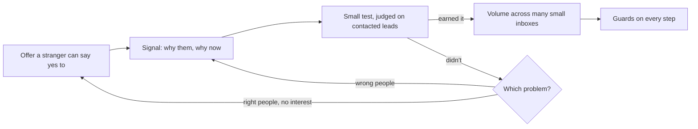

# How I think about outbound

[How I build outbound from scratch](outbound-from-scratch.md) is the order I set a system up in. This page is why it's built that way: what I believe about cold traffic, offers, testing, volume and sending infrastructure, and the campaigns that taught me each one. Everything here comes from running cold email for B2B clients at Breezy Growth.

**The short version**

- The offer decides the result more than the list or the copy.
- A stranger needs a reason to hear from you today, so every campaign starts from a public signal.
- Test small and judge on contacted leads. Volume goes only to what earned it.
- Volume comes from many small inboxes on many domains, never a few big ones.
- Contacts before inboxes. A fleet with no list to send is just a bill.
- Rules live in code that blocks the action, not in my memory.

## 1. The offer decides the result

Cold traffic doesn't know you, doesn't trust you and wasn't looking for you. Better copy can't fix that. What fixes it is giving them something concrete enough to say yes to without a meeting.

On my own campaigns, when the first email offered something specific (a named building that needed a cleaner, an open public bid with a deadline), 0.77% of the companies contacted answered with interest. When it offered a service, 0.25%. The markets differed too, so it isn't a clean test, but the offer was the biggest change between them.

So the order I work in is:

- **Who it's for and what they'd call the outcome**, in their words, not ours.
- **A small first yes.** A reply of a few words, not a 30-minute call with a stranger.
- **Belief before price.** Proof from their own world first. The price comes up on the call.
- **The offer gets checked before anyone writes copy.** When replies stop, I look at the offer before I rewrite a line.

## 2. Every email needs a reason to exist today

The inboxes I send to are numb. Owners and VPs get the same "quick question" email over and over. A list pulled from industry and headcount alone gives them no reason to read past the first line.

So every campaign starts from something public that makes the email timely: a job post for the role the offer replaces, a funding round, a public bid, a contract about to end, a new location. The signal decides who goes on the list, and it gives the first line something true to say about them. It also keeps lists small, which is the point: fewer companies, each with a reason.

I also sell the outcome, not the mechanism. Nobody cares how many inboxes or which enrichment tool. They care about the result and how long it takes.

## 3. Test small, then earn volume

A new market or angle starts as a test, never a launch:

- **Count the market first, for free.** If the whole market is 13 firms, a test can't reach a verdict, and no amount of copy changes that.
- **A 10-lead preview before a full list.** Ten real leads and the copy go to the client before any money goes into scraping and verifying hundreds. If the angle is wrong, we find out for the cost of ten rows.
- **One change at a time.** Every variant keeps the same ask, so a test measures the line that changed.
- **Rates on contacted leads, never on replies.** Autoresponders and departed employees reply too. One campaign had 8 replies from 576 sends and none of them were from a person.
- **No verdict on noise.** There's a minimum number of contacted leads before I call anything, and an A/B winner has to pass an exact test.

Most tests lose, and that's fine as long as they're cheap and the loss is recorded. My own campaigns are on a [public scoreboard](https://github.com/Trav54219/gtm-engineering-portfolio/blob/main/campaigns/scoreboard.md), misses included: 13 campaigns, 926 contacted, 7 raw replies. The HVAC owner campaign that sent about 2,000 emails to 717 owners and got 19 replies, all machine or wrong person, taught me more than a win would have. Deliverability had passed, so the list was the problem, and the next campaign changed the audience instead of the wording.

When something does work, it gets volume: more of the same signal, the same offer and the same audience, on more inboxes.

## 4. Volume comes from many small inboxes

I'd rather send 10 cold emails a day from each of 225 inboxes than 200 a day from a dozen.

- **Each inbox is rated at 40 emails a day, warm-up included.** At a 3:1 warm-up to cold ratio that's 10 cold and 30 warm-up per inbox. I plan volume from that number, not from what the sequencer allows.
- **A few inboxes per domain, many domains.** The fleet runs 225 inboxes across 75 domains. Reputation is earned per inbox and per domain, so when one gets flagged, the campaign loses a small slice of its capacity instead of all of it.
- **Generic domains, never the client's brand.** A burned domain shouldn't take the client's real email down with it.
- **A domain stays on its campaign until the campaign ends.** Rotating mid-campaign throws away the reputation the inbox earned and breaks reply threads.
- **Warm-up is measured, not assumed.** Raising the warm-up reply rate from 30% to 40% cut spam placement from 33.9% to 12.2%, while a control group left alone didn't move.

Spreading out has a limit I learned the hard way. Every inbox in the fleet sent through one shared relay, and when that relay landed on Spamhaus, 75 domains didn't help. That's the [deliverability incident](deliverability-incident.md): 309 accounts replaced and 37 campaigns re-attached with zero mismatches. Now I check the relay, not just the domains.

## 5. Contacts before inboxes

Sending capacity is easy to buy. Leads worth emailing aren't. At one point the fleet could carry far more email than we had verified, on-target contacts to send, and every unused inbox still cost money and still needed warming.

So the fleet gets sized to the list, not to the size of the market. When lead supply is the constraint, I take the slower 3:1 warm-up ratio, because spare send capacity is worth less than inbox reputation.

## 6. Rules live in code

Each of these beliefs is enforced somewhere it can't be skipped. A campaign can't start without a fresh preflight pass. Leads can't be added to a campaign that's already sending. Paid verification refuses a company that never passed the free filter. Copy fails on a broken spintax branch or an AI tell. The guards run as hooks on the tool call itself, because a reminder doesn't stop a tired person or a second agent session, and a hook does.

Most of those rules exist because something went wrong once. The step-by-step version, with what each guard caught, is [how I build outbound from scratch](outbound-from-scratch.md), and the [guard code is public](https://github.com/Trav54219/gtm-engineering-portfolio/tree/main/guards).
