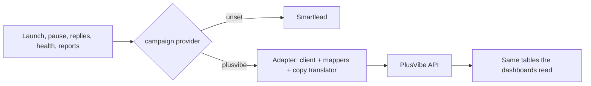

# Moving a production outbound system to a second sequencer: merged, switched off

**How I know it works so far:** 6 pull requests merged to production, **123 tests passing** across 9 files, and every Smartlead campaign still on its original path. It has **not** run against the live PlusVibe API yet. The key comes with the Business plan in late November, so the first live run is the real test, and the turn-on doc lists what to check.

Built with: TypeScript, Next.js, Convex, Vitest, the PlusVibe and Smartlead APIs

**The problem:** my client portal ran launches, lead pushes, pauses, copy, settings, human replies, about ten automated reply features, sender health and reporting on Smartlead. Moving sending to PlusVibe could not mean rewriting all of that, or risking a live campaign.

**What I built**
1. A provider switch on each campaign. PlusVibe campaigns go through an adapter, and every other campaign keeps its Smartlead path unchanged.
2. A client with a 5 requests per second limit, 429 backoff that respects `Retry-After`, and errors that say whether they're safe to retry.
3. Mappers that turn PlusVibe's responses into the shapes the dashboards already read, so reporting needed no change.
4. A copy translator from Smartlead syntax to PlusVibe syntax. It refuses copy it can't translate safely and doesn't guess.
5. One reply route for every automated sender. Each feature changed by one call, and the live-thread guard reads the PlusVibe thread before anything sends.
6. A launch block on unhealthy inboxes: not active, in recovery, warm-up off, or under 90% seven-day warm-up health.
7. Two separate switches for reads and writes. While they're off, every entry point does nothing and says why.

**The map**

**What broke**
- A Convex action returning another action's result without an explicit return type made `tsc` report about 100 errors in unrelated files.
- A reply send that fails with no response may still have gone out. Smartlead once sent one reply 5 times through a retry loop. So ambiguous failures (no response, 408, 5xx) are never resent, and only a 4xx counts as safe to retry.
- Variant ids, click counts and the bounce split by cause have no clean PlusVibe equivalent. They're listed as gaps, not approximated.

**What I'd do next:** the first live run with the turn-on checklist, then forwarding, label sync and the mailbox-side writes.

**Read it:** [the write-up with code excerpts](https://github.com/Trav54219/gtm-engineering-portfolio/tree/main/projects/08-plusvibe-integration). The portal itself is a private repo.
