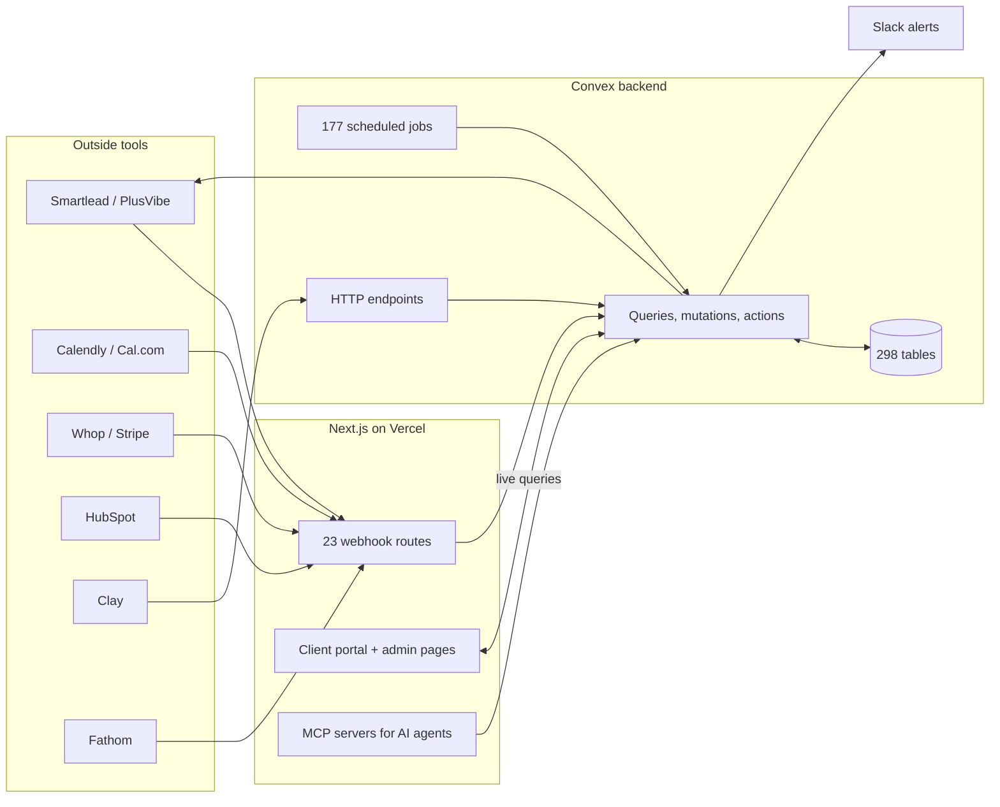
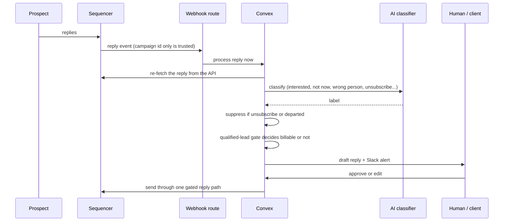
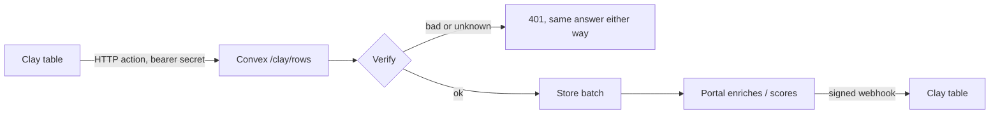

# How the client portal is built

The portal runs my company's outbound for live clients: campaigns, replies, approvals, billing, reporting and the AI agents that work inside it. The repo is private, so this page shows the architecture and the reasons behind it, not the code. Every count below is from the main branch on 2026-11-01.

**Size:** 1,822 commits since June 2026 · 298 database tables · 177 scheduled jobs · 23 inbound webhooks · 77 API routes · 166 pages · 1,025 test files

Built with: TypeScript, Next.js (App Router), Convex, Tailwind, Vercel, Whop and WorkOS for sign-in, Vitest, Playwright

## The whole system

Three parts. Next.js handles pages and the doors other tools knock on. Convex holds the data, the business logic and every scheduled job, in one TypeScript codebase. Outside tools send events in and get calls back out.

## A reply, from the prospect's inbox to an invoice

This is the path that matters most, because a slow or wrong reply loses a client a meeting.

The decisions in it:

- **The webhook body isn't trusted.** The route reads only the campaign id, and Convex re-fetches the reply from the sequencer's API. Classification, the qualified-lead gate and billing all read the same copy, and the one shape I don't control never reaches them.
- **Webhooks are the fast path, a cron is the backstop.** Without the webhook, a reply would wait up to 15 minutes for the sync job. With it, processing starts right away, and the sync still catches anything a webhook dropped. Separate jobs retry failed classifications and repair the pipeline if it falls behind.
- **One send path for every automated reply.** About ten features can send a reply. All of them go through one gated function, and that function checks the live thread before anything goes out. A failure with no response is never resent, because the reply may already have gone out.
- **Billing is a gate, not a count.** A reply only becomes a billable lead after the qualified-lead gate. Replies it rejects are logged with a reason instead of silently dropped.

## Scheduled jobs replace the manual checklist

177 jobs run on timers. Some examples, grouped by what they protect:

| Area | Jobs |
|---|---|
| Replies | sequencer sync, classification retry, reply pipeline health, reply repair sweep |
| Sending health | warm-up stats sync, warm-up watch, warm-up replenishment, DNS auth sync, bounce analysis |
| Money | billing cap sweep, financial digest, nightly ads kill line |
| Clients | churn risk digest, weekly performance digest, health scores, lead digest emails |
| Team | end-of-day sweep, staff idle alert, meeting prep |

Most of them post to Slack or roll into a digest, so problems come to me instead of waiting for me to check.

## Two-way Clay bridge

Clay can push enriched rows into the portal and get them back after the portal works on them.

- Clay's HTTP action can set a header but can't compute a signature, so the bridge takes either a bearer secret or a Standard Webhooks signature over the raw body.
- A missing connection and a wrong secret return the same 401, so nobody can probe for valid connection ids.
- Signing secrets are encrypted at rest, and an outbound webhook can only go to a public address.

## AI agents work through MCP, not the database

AI agents (mine, and clients' own) reach the portal through MCP servers: one for a client's own account, one for GTM work, one for support tickets. Each client key is scoped to that client and scrubbed from logs. An agent can read campaigns and file tickets without ever holding a database credential.

## Rules the code enforces

- **A database blip never signs a client out.** "Couldn't reach the database" is never treated as "your account doesn't exist" or "your session expired." Both bugs logged real clients out once. A test now pins the rule.
- **Open tabs survive deploys.** A tab left open across a deploy reloads its stale code quietly instead of erroring on every click. Changes to public functions stay additive, because an open tab runs yesterday's code against today's backend.
- **There's no staging, so deploys are batched.** A merge to main runs the whole test suite before it builds, and a failing test blocks the deploy. The backend deploy can also run by hand from an exact commit in a clean worktree: dry run, deploy, then a record of the SHA.
- **Several agents share the repo, so the workflow is built for it.** Each change goes in its own worktree, files are staged by path, and a git hook refuses a commit made directly on main.

## What I'd change

Add a staging environment. Batched deploys and additive changes work, but they rely on discipline.

**More:** [How I chose the stack](stack-decisions.md) · [The second-sequencer integration](plusvibe-integration.md) · [The deliverability incident](deliverability-incident.md)
