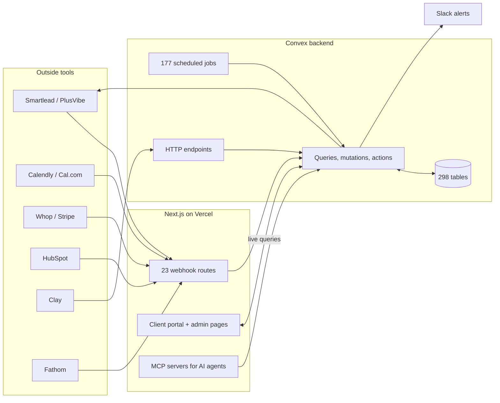
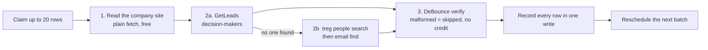
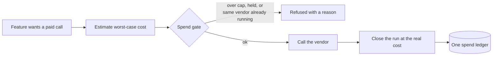
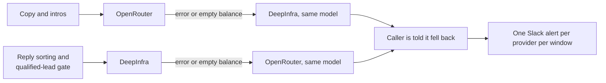
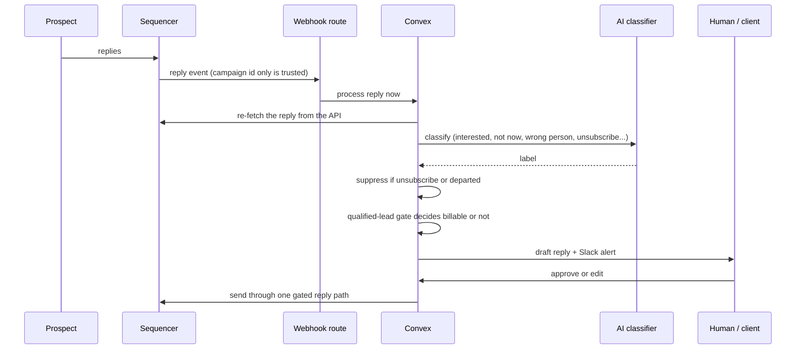
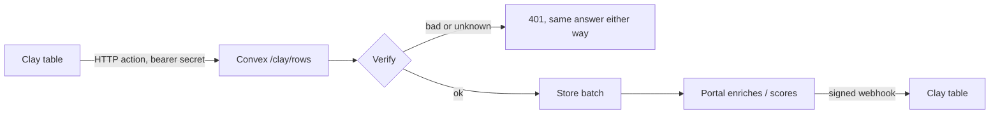

# How the client portal is built

The portal runs my company's outbound for live clients: campaigns, replies, approvals, billing, reporting and the AI agents that work inside it. The repo is private, so this page shows the architecture and the reasons behind it, not the code. Every count below is from the main branch on 2026-11-01.

**Size:** 1,822 commits since June 2026 · 298 database tables · 177 scheduled jobs · 23 inbound webhooks · 49 outside services · 77 API routes · 166 pages · 1,025 test files

Built with: TypeScript, Next.js (App Router), Convex, Tailwind, Vercel, Whop and WorkOS for sign-in, Vitest, Playwright

## The whole system

Three parts. Next.js handles pages and the doors other tools knock on. Convex holds the data, the business logic and every scheduled job, in one TypeScript codebase. Outside tools send events in and get calls back out.

## Every outside API, how it's used and why

Every key lives in the Convex production environment, never in the browser or the frontend host. An integration with no key set does nothing and says so, instead of failing, so a new vendor can be wired in before it's paid for.

### Sending and inbox infrastructure

| Service | How the portal uses it | Why |
|---|---|---|
| Smartlead | Campaigns, leads, sequences, A/B stats, replies, warm-up stats. 7 webhooks plus a sync job every 15 minutes. | The sequencer every live campaign runs on. |
| PlusVibe | A full adapter behind a per-campaign provider switch, with separate switches for reads and writes. | Better pricing per email sent at fleet volume. [Write-up](plusvibe-integration.md). |
| Inframail, Mailforge | Create and delete sending mailboxes per client, pull their SMTP and IMAP details, connect them to Smartlead. | Inboxes are tracked per client, so deleting a churned client's inboxes is one action. |
| ScaledMail | Reads orders and status. Buying domains is a deliberate, admin-only click. | Anything that charges money is never automatic. |
| MailReef | Read-only, by policy. A job writes live usage into the spend ledger. | Its write endpoints buy domains and servers. The ledger replaced typing invoices in by hand. |

### Lead data and enrichment

| Service | How the portal uses it | Why |
|---|---|---|
| treg | People search and email find in the lead build, after GetLeads. Every call carries a maximum cost, so one call can't charge more than its cap. | One key in front of many priced data endpoints, so each step uses the cheapest provider that works. |
| GetLeads | First step for finding decision-makers in the lead build, paced under 80 calls a minute per job. | It answers decision-maker lookups directly. Slow or empty answers are retried, never stored as a miss. |
| Blitz, Prospeo | Email-finding steps in the CRM enrichment waterfall. | A waterfall stops at the first hit, so the cheaper source goes first. |
| DeBounce | Verifies every address before it's used. A malformed address is rejected before it costs a credit. | Bounces burn sending domains. |
| TinyFish, ZenRows | Read company websites: TinyFish first, ZenRows as the fallback. Used for enrichment, offer profiles and the competitor sweep. | Website text is the cheapest research there is, and the fallback covers sites that block plain fetches. |
| Apify, Firecrawl, Serper | Balance checks only, synced into the spend dashboard. | Every prepaid credit is visible in one place before it runs out. |

### AI models

| Service | How the portal uses it | Why |
|---|---|---|
| DeepInfra | Default for high-volume work: reply classification and the qualified-lead gate. | Cheap and called constantly. |
| OpenRouter | First choice for copy and introductions. Each call is tagged with the app, so spend can be traced. | The best model for the output that matters most. |
| OpenAI | Direct model access in the router. | A third provider behind the same interface. |
| TypeSafe | A decision model: typed questions in, one typed answer each. | Yes/no and category calls shouldn't be parsed out of free text. |
| Anthropic, OpenAI, OpenRouter, DeepInfra billing APIs | Read-only spend sync into the AI cost dashboard. | Cost per client and per feature, not one monthly total. |

### Money, contracts and sign-in

| Service | How the portal uses it | Why |
|---|---|---|
| Whop | Payments, invoices, memberships and sign-in, plus 2 webhooks. Invoices are created and sent automatically. | A named account team handles billing problems. Nobody hand-sends an invoice. |
| Stripe | The earlier billing path. Clients on it update cards through Stripe's hosted billing portal. | The portal never touches card data. |
| eSignatures | Sends contracts, receives the signed webhook and keeps its own copy of the signed PDF. Only one contract can go out per client at a time. | A double click once could send two contracts. A link to someone else's PDF isn't a record. |
| WorkOS | Sign-in for the first version, still on for one client account. | Changing sign-in providers can't lock out a client. |

### Calendars, calls and meetings

| Service | How the portal uses it | Why |
|---|---|---|
| Google Calendar | Each rep connects their own calendar. The inbox shows their real free slots and books a real event with the prospect invited. | Booking from the reply itself is the fastest way from reply to meeting. |
| Calendly, Cal.com | Fallbacks when a rep has no Google Calendar connected, each with OAuth and webhooks. | Reps book on whatever tool they already use. |
| Fathom | Client-connected call recordings, pulled for meeting history and reviving old deals. | Past calls are context the AI can use, with the client's consent. |
| Quo | Every booked call with a phone number becomes a contact on my own line, tagged with whether they agreed to texts. Nothing sends a text. | One-tap follow-up without risking unwanted texts. |

### CRM delivery and Clay

| Service | How the portal uses it | Why |
|---|---|---|
| HubSpot, Salesforce | Sync into a local mirror of the client's CRM. Every cleanup, enrichment and scoring change is a change set that can be rolled back. | A bad bulk edit to a client's CRM has to be reversible. |
| Pipedrive, Close, Attio, GoHighLevel | OAuth connect and lead delivery. A failed delivery retries with backoff before it asks a person. | A lead the client never sees is a lead they didn't pay for. |
| Clay | The two-way bridge described below. | Clients and staff already enrich in Clay tables. |

### Social, ads and media

| Service | How the portal uses it | Why |
|---|---|---|
| Zernio | Social posting, ad accounts, DMs, comments and client phone numbers, with signed webhooks. | One API for the networks, so each network isn't a separate integration. |
| Meta Ad Library | The weekly competitor sweep reads competitors' live ads. | Competitor ads show which offers they're paying to push. |
| HeyGen, ElevenLabs, Higgsfield | Client avatar videos and voice clones, gated behind the client's own consent. | Video at scale without a filming day. |
| Google Business Profile | 4 drafted posts a month per local client, held for staff review. | Drafts are never auto-published. |

### Running the team

| Service | How the portal uses it | Why |
|---|---|---|
| Slack | Ops alerts by webhook. A bot creates each client's channel, sends the Slack Connect invite and posts booked calls. | Clients and staff already live in Slack. |
| Linear | When a contract is signed, a project for that client is created with the fulfillment checklist. | Onboarding starts as a ready queue, not something to remember. |
| Resend | Transactional email to clients, such as a broken-calendar alert with a reconnect link. | Kept off the cold-email fleet, so client notices don't land in spam. |
| Photon | iMessage alerts to reps on speed-to-lead hand-offs, opt-in per rep. | A text gets seen faster than an email. |
| Web Push | Browser notifications per device for client users. | Hot replies reach a client without the tab open. |
| Sentry | Error reporting from the frontend. | A deploy that catches an open tab reloads quietly and isn't counted as an error. |

## The lead build, step by step

The lead build turns a list of companies into verified decision-makers, with treg in the middle.

- A batch claims its rows first. If the worker crashes halfway, the rows go back to the queue on their own instead of getting stuck.
- Each treg call carries a cost cap, and a batch only makes the call if the budget still covers that cap.
- Each row remembers which step it reached, so a retry starts where it stopped instead of paying for the same lookup twice.

## Every paid call goes through one spend gate

The gate exists so a teammate can be handed vendor keys safely. Two rules came from real losses:

- **Never loop a paid endpoint.** Every runaway bill came from a loop, not from one expensive call. So the gate refuses a second run for the same vendor while one is still going.
- **A dry run isn't free until proven.** One "dry run" cost about $76. Dry runs are estimated, capped and approved like real runs.

What runs are about to spend (the gate) and what was actually paid (the ledger) end up in the same table, so there's one set of numbers.

## The AI router falls back both ways

- The copy path runs a few times a week, so it's the least-tested path and the costliest one to fail silently. If it fails, it falls back to DeepInfra.
- The reverse fallback exists because DeepInfra's balance ran out on 2026-09-29, which took down reply classification and the qualified-lead gate.
- A fallback looks up the model under the other provider's name, so the safety net doesn't fail on an unknown model id. A fallback never chains: if both wallets are empty, the call errors instead of looping.
- "Out of money" and "temporary error" are handled differently. A 429 fixes itself, an empty balance doesn't, so only an empty balance triggers the alert.

## A reply, from the prospect's inbox to an invoice

This is the path that matters most, because a slow or wrong reply loses a client a meeting.

The decisions in it:

- **The webhook body isn't trusted.** The route reads only the campaign id, and Convex re-fetches the reply from the sequencer's API. Classification, the qualified-lead gate and billing all read the same copy, and the one shape I don't control never reaches them.
- **Webhooks are the fast path, a cron is the backstop.** Without the webhook, a reply would wait up to 15 minutes for the sync job. With it, processing starts right away, and the sync still catches anything a webhook dropped. Separate jobs retry failed classifications and repair the pipeline if it falls behind.
- **One send path for every automated reply.** About ten features can send a reply. All of them go through one gated function, and that function checks the live thread before anything goes out. A failure with no response is never resent, because the reply may already have gone out.
- **Billing is a gate, not a count.** A reply only becomes a billable lead after the qualified-lead gate. Replies it rejects are logged with a reason instead of silently dropped.

## Scheduled jobs replace the manual checklist

177 jobs run on timers. Some examples, grouped by what they protect:

| Area | Jobs |
|---|---|
| Replies | sequencer sync, classification retry, reply pipeline health, reply repair sweep |
| Sending health | warm-up stats sync, warm-up watch, warm-up replenishment, DNS auth sync, bounce analysis |
| Money | billing cap sweep, financial digest, nightly ads kill line |
| Clients | churn risk digest, weekly performance digest, health scores, lead digest emails |
| Team | end-of-day sweep, staff idle alert, meeting prep |

Most of them post to Slack or roll into a digest, so problems come to me instead of waiting for me to check.

## Two-way Clay bridge

Clay can push enriched rows into the portal and get them back after the portal works on them.

- Clay's HTTP action can set a header but can't compute a signature, so the bridge takes either a bearer secret or a Standard Webhooks signature over the raw body.
- A missing connection and a wrong secret return the same 401, so nobody can probe for valid connection ids.
- Signing secrets are encrypted at rest, and an outbound webhook can only go to a public address.

## AI agents work through MCP, not the database

AI agents (mine, and clients' own) reach the portal through MCP servers: one for a client's own account, one for GTM work, one for support tickets. Each client key is scoped to that client and scrubbed from logs. An agent can read campaigns and file tickets without ever holding a database credential.

## Rules the code enforces

- **A database blip never signs a client out.** "Couldn't reach the database" is never treated as "your account doesn't exist" or "your session expired." Both bugs logged real clients out once. A test now pins the rule.
- **Open tabs survive deploys.** A tab left open across a deploy reloads its stale code quietly instead of erroring on every click. Changes to public functions stay additive, because an open tab runs yesterday's code against today's backend.
- **There's no staging, so deploys are batched.** A merge to main runs the whole test suite before it builds, and a failing test blocks the deploy. The backend deploy can also run by hand from an exact commit in a clean worktree: dry run, deploy, then a record of the SHA.
- **Several agents share the repo, so the workflow is built for it.** Each change goes in its own worktree, files are staged by path, and a git hook refuses a commit made directly on main.

## What I'd change

Add a staging environment. Batched deploys and additive changes work, but they rely on discipline.

**More:** [How I chose the stack](stack-decisions.md) · [The second-sequencer integration](plusvibe-integration.md) · [The deliverability incident](deliverability-incident.md)
