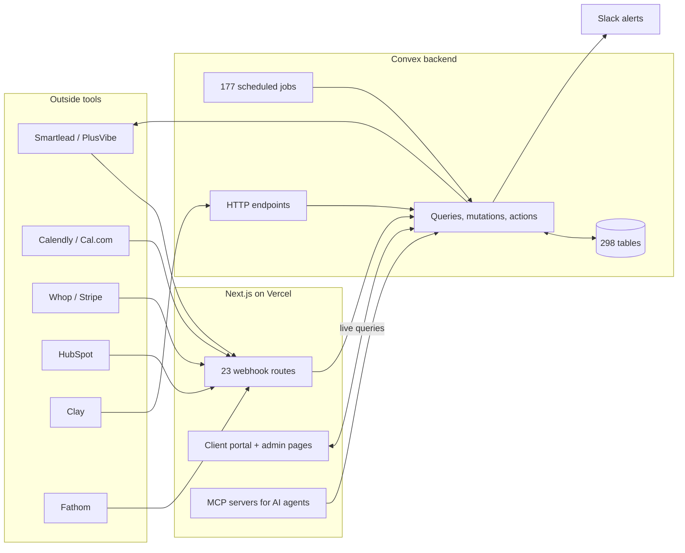
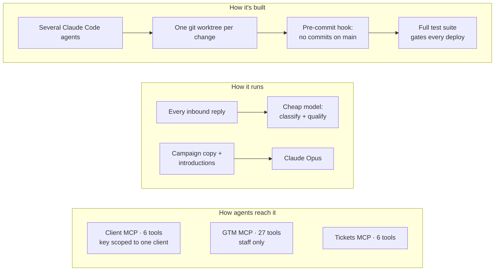
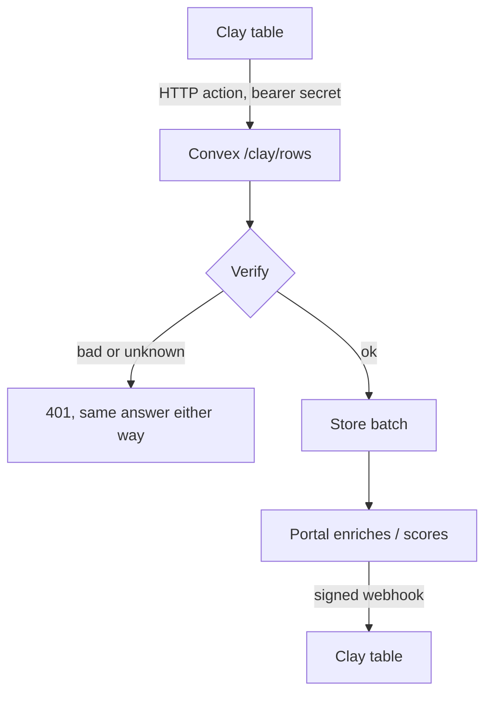
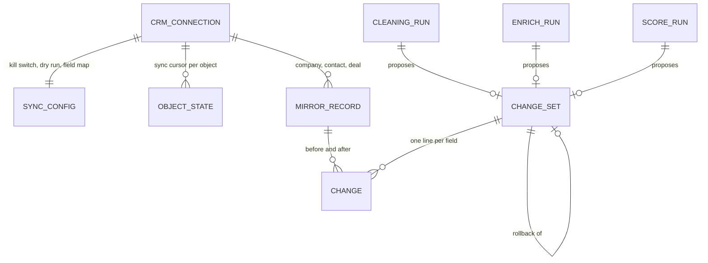
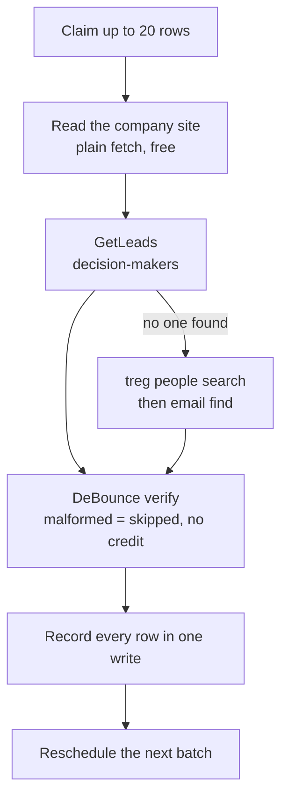
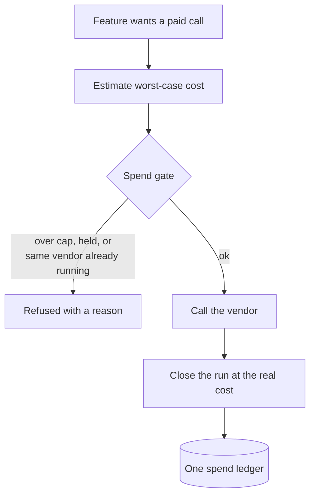
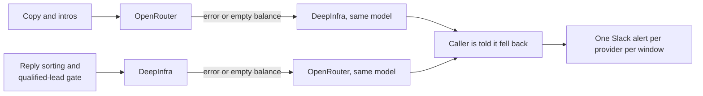
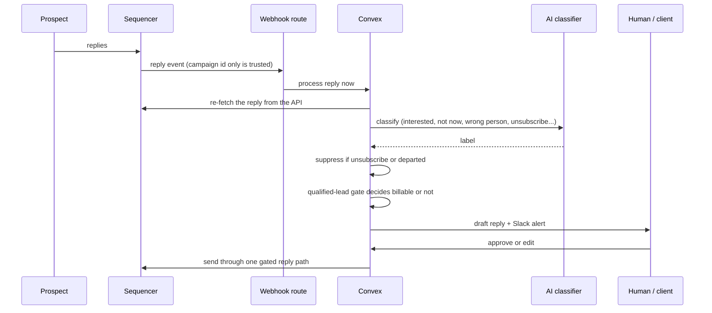

# How the client portal is built

The portal runs Breezy Growth's outbound for live clients: lead builds, campaigns, replies, billing, reporting and the AI agents that work inside it. Every part of it exists to move one number: qualified sales opportunities delivered to a client, at a cost that leaves margin. The repo is private, so this page shows the architecture and the reasons behind it, not the code.

**Size:** 298 database tables · 177 scheduled jobs · 23 inbound webhooks · 49 outside services · 77 API routes · 166 pages · 1,025 test files

Built with: TypeScript, Next.js (App Router), Convex, Tailwind, Vercel, Whop and WorkOS for sign-in, Vitest, Playwright, Claude

## What it delivered

| Client | Result | Time |
|---|---|---|
| Regent Peak Wealth Advisors | 6 qualified introductions | 45 days |
| Elate Staffing | 22 placements | 55 days |
| Crawford Thomas Recruiting | 39 candidate placements | one quarter |

Each number is stated the way the client's case study states it, with the time it took. [Every engagement](client-results.md).

## The whole system

Three parts. Next.js handles pages and the doors other tools knock on. Convex holds the data, the business logic and every scheduled job, in one TypeScript codebase. Outside tools send events in and get calls back out.

## Built with Claude, run on Claude

- **Model choice follows one rule.** High volume and recoverable gets the cheap model. Low volume and irreversible gets the best one. Reply sorting runs on every reply, and a wrong label gets fixed by the next person who reads the thread. Campaign copy is written once and sent thousands of times, and a bad introduction burns both sides, so those run on Claude Opus.
- **Agents never touch the database.** Mine and clients' own agents reach the portal through MCP servers. A client key only sees that client's data and is scrubbed from logs. My own operating view (campaigns, hot replies, spend, domain health) is 27 MCP tools I call from Claude every day.
- **The repo is built for several agents at once.** Each change goes in its own worktree, files are staged by path, and a git hook refuses a commit made directly on main. Every merge runs the full test suite before it builds.
- **AI output is graded before it ships.** Every prompt change to the reply AI runs against a test set of 475 prospect replies. Each draft is scored on six criteria, and every score has to quote the draft. [The eval](ai-inbox-eval.md).

## The outside APIs and why each one is there

Every key lives in the Convex production environment, never in the browser. An integration with no key set does nothing and says so, so a new vendor can be wired in before it's paid for.

### Sending

| Service | How the portal uses it | Why it matters |
|---|---|---|
|  Smartlead | Campaigns, leads, sequences, A/B stats, replies, warm-up stats. 7 webhooks plus a sync job every 15 minutes. | The sequencer the live campaigns ran on. |
|  PlusVibe | A full adapter behind a per-campaign provider switch. | Lower cost per email at fleet volume. Switching sequencers is a setting, not a rebuild. |
|  Inframail  Mailforge | Create and delete sending mailboxes per client and connect them to the sequencer. | Inbox cost is tracked per client, so margin per account is real. |

### Lead data and enrichment

| Service | How the portal uses it | Why it matters |
|---|---|---|
|  GetLeads | First step for finding decision-makers, paced under 80 calls a minute. | Slow or empty answers are retried, never stored as a miss. |
|  treg | People search and email find after GetLeads. Every call carries a maximum cost. | One key in front of many providers, so each step uses the cheapest one that works. |
|  Blitz  Prospeo | Email-finding steps in the enrichment waterfall. | The waterfall stops at the first hit, so the cheaper source goes first. |
|  DeBounce | Verifies every address before it's used. | Bounces burn sending domains, and burned domains stop pipeline. |
|  TinyFish  ZenRows | Read company websites for enrichment and offer research, with a fallback. | Website text is the cheapest research there is. |

### AI models

| Service | How the portal uses it | Why it matters |
|---|---|---|
|  DeepInfra | Reply classification and the qualified-lead gate. | Cheap, and called on every reply. |
|  OpenRouter | Copy and introductions, each call tagged so spend can be traced. | The best model goes on the output a prospect reads. |
|  TypeSafe | Typed questions in, one typed answer each. | Yes/no and category calls shouldn't be parsed out of free text. |

### Money, CRM and calendars

| Service | How the portal uses it | Why it matters |
|---|---|---|
|  Whop  Stripe | Payments, invoices and memberships. Invoices are created and sent automatically. | Nobody hand-sends an invoice, so revenue doesn't wait on a person. |
|  eSignatures | Sends contracts and keeps its own copy of the signed PDF. | A signed contract kicks off onboarding with no hand-off. |
|  HubSpot  Salesforce | Sync into a local mirror of the client's CRM. Every cleanup or enrichment is a change set that can be rolled back. | A bad bulk edit to a client's CRM has to be reversible. |
|  Pipedrive  Close  Attio  GoHighLevel | Lead delivery. A failed delivery retries with backoff before it asks a person. | A lead the client never sees is a lead they didn't pay for. |
|  Google Calendar | Each rep connects their calendar. The inbox shows real free slots and books the meeting from the reply. | The shortest path from reply to meeting. |
|  Slack | Ops alerts, a channel per client, booked calls posted live. | Problems and wins reach people where they already work. |

## Two-way Clay bridge

Clay can push enriched rows into the portal and get them back after the portal works on them.

- Clay's HTTP action can set a header but can't compute a signature, so the bridge accepts a bearer secret or a signature over the raw body.
- A missing connection and a wrong secret return the same 401, so nobody can probe for valid ids.
- Signing secrets are encrypted at rest, and an outbound webhook can only go to a public address.

## The CRM data model

Every client CRM is mirrored into the portal. Cleanup, enrichment and scoring are computed against the mirror, and the only thing that ever writes back to the client's CRM is an approved change set.

- **Every change is one field, with its before and after value.** When a change set is submitted, each "before" is checked against the mirror as it is now. If the record has moved, that line is marked stale and is never written.
- **The first write to a client's CRM needs a named approval.** Each connection also has a kill switch and a dry-run-only mode.
- **Rollback is a change set too.** It builds the inverse lines. A field that changed in the CRM since then is left alone, not overwritten.
- **Duplicates are proposed, never merged automatically.** Companies match on domain (taken from the website when the domain field is empty), contacts on name plus company or a shared phone. In the HubSpot test build, the merge logic went 48 for 48 against an answer key, including 6 decoys. [The test build](crm-cleanup.md).
- **Sync is incremental.** Each object type keeps its own cursor, status and retry time, so one failing object doesn't stop the others.

## The lead build, step by step

- A batch claims its rows first. If the worker crashes, the rows go back to the queue instead of getting stuck.
- Each row remembers which step it reached, so a retry never pays for the same lookup twice.
- Free steps run before paid ones. Cost per verified contact is what decides whether a campaign makes money.

## Every paid call goes through one spend gate

- **Never loop a paid endpoint.** Every runaway bill came from a loop, not one expensive call, so the gate refuses a second run on a vendor that's already running.
- **A dry run isn't free until proven.** One "dry run" cost about $76. Dry runs are now estimated and capped like real runs.
- What's about to be spent and what was actually paid land in one table, so cost per client is one query.

## The AI router falls back both ways

- The reverse fallback exists because DeepInfra's balance ran out on 2026-09-29 and took down reply classification. Replies that aren't sorted are meetings that don't get booked.
- A fallback never chains. If both wallets are empty, the call errors instead of looping.
- A 429 fixes itself and an empty balance doesn't, so only an empty balance alerts.

## A reply, from the prospect's inbox to an invoice

This is the path that matters most, because a slow or wrong reply loses a client a meeting.

- **The webhook body isn't trusted.** Convex re-fetches the reply from the API, so classification, the gate and billing all read the same copy.
- **Webhooks are the fast path, a cron is the backstop.** Processing starts right away, and a 15-minute sync catches anything a webhook dropped.
- **One send path for every automated reply.** About ten features can send a reply, all through one function that checks the live thread first.
- **Billing is a gate, not a count.** A reply only becomes a billable opportunity after the qualified-lead gate, and rejections are logged with a reason.

## Scheduled jobs replace the manual checklist

| Area | Jobs |
|---|---|
| Replies | sequencer sync, classification retry, reply pipeline health, reply repair sweep |
| Sending health | warm-up stats, warm-up replenishment, DNS auth sync, bounce analysis |
| Money | billing cap sweep, financial digest, nightly ads kill line |
| Clients | churn risk digest, weekly performance digest, health scores |

177 jobs in all. Most post to Slack or roll into a digest, so problems come to me instead of waiting for me to check.

## Rules the code enforces

- **A database blip never signs a client out.** That bug logged real clients out once. A test now pins the rule.
- **Open tabs survive deploys.** Changes to public functions stay additive, because an open tab runs yesterday's code against today's backend.
- **Anything that costs money is a deliberate click.** Domain and inbox purchases are never automatic.

## What I'd change

Add a staging environment. Batched deploys and additive changes work, but they rely on discipline.

**More:** [Full architecture write-up](portal-architecture.md) · [How I chose the stack](stack-decisions.md) · [The deliverability incident](deliverability-incident.md)
