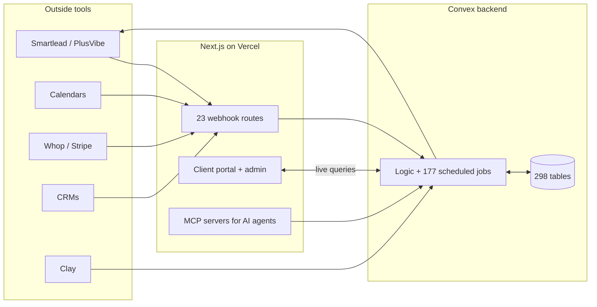
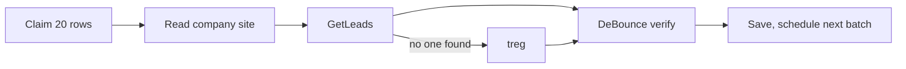
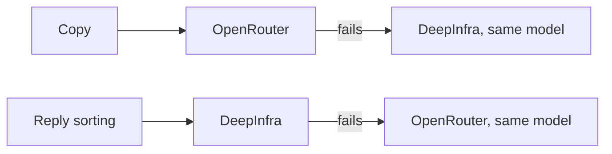
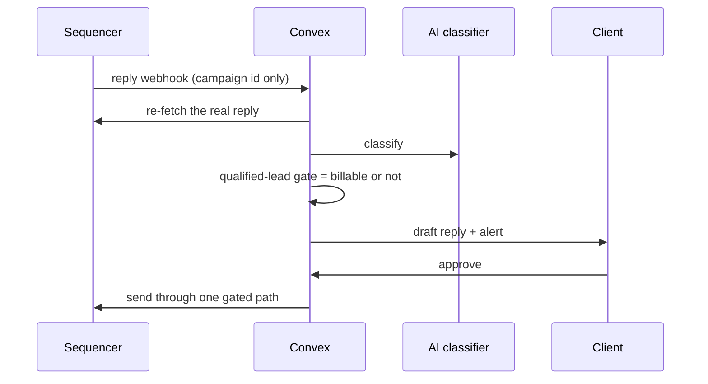

# The client portal in 5 minutes

The portal runs Breezy Growth's outbound for live clients: campaigns, replies, billing, reporting and the AI agents that work inside it. The repo is private, so this shows the architecture and the reasons, not the code. Full version: [How the client portal is built](portal-architecture.md).

**Size:** 298 database tables · 177 scheduled jobs · 23 inbound webhooks · 49 outside services · 77 API routes · 1,025 test files

Built with: TypeScript, Next.js, Convex, Vercel, Vitest, Playwright

## 1. The whole system

Next.js serves the pages and receives events. Convex holds the data, the logic and every scheduled job in one TypeScript codebase.

## 2. 49 outside services

| Area | Services | The rule |
|---|---|---|
| Sending | Smartlead, PlusVibe, Inframail, Mailforge | One provider switch per campaign. Inboxes tracked per client. |
| Lead data | GetLeads, treg, Blitz, Prospeo, DeBounce | Cheapest source first, every address verified before use. |
| AI | DeepInfra, OpenRouter, OpenAI, TypeSafe | Cheap model for volume, best model for copy. |
| Money | Whop, Stripe, eSignatures | Invoices send themselves. Buying anything is never automatic. |
| CRM | HubSpot, Salesforce, Pipedrive, Close, Attio, GHL, Clay | Every CRM change can be rolled back. |
| Team | Slack, Linear, Resend, Sentry | Problems come to me in Slack. |

Every key lives in the backend. An integration with no key does nothing and says so.

## 3. Lead build and the spend gate

- Rows are claimed first, so a crash puts them back in the queue.
- Each row remembers its last step, so a retry never pays twice.
- Every paid call goes through one gate: worst-case cost estimated, capped, and refused if the same vendor is already running. Every runaway bill I've had came from a loop.

## 4. AI router falls back both ways

Built after DeepInfra's balance ran out on 2026-09-29 and stopped reply classification. A fallback never chains, and an empty balance alerts Slack once.

## 5. A reply, from inbox to invoice

- The webhook body isn't trusted. Convex re-fetches the reply from the API.
- Webhook is the fast path, a 15-minute sync is the backstop.
- About ten features can send a reply, all through one function that checks the live thread first.
- A reply is only billed after the qualified-lead gate, and rejections are logged with a reason.

## 6. Jobs, Clay and agents

- **177 scheduled jobs** replace the manual checklist: reply sync, warm-up health, billing caps, churn risk, weekly digests.
- **Two-way Clay bridge:** Clay pushes rows in with a bearer secret, the portal enriches them and sends them back by signed webhook.
- **AI agents use MCP, not the database.** Each client key only sees that client's data.

## 7. Rules the code enforces

- A database blip never signs a client out.
- Open tabs survive deploys.
- Every merge runs the full test suite, and a failing test blocks the deploy.
- **What I'd change:** add a staging environment.
