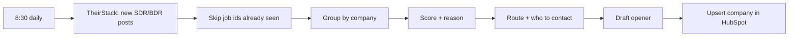

# Signal to CRM, on a schedule: running daily

**How I know it works:** on the first run, 20 SDR and BDR job posts became 18 HubSpot companies. Each one has a fit score, the arithmetic behind it, a route, the title to contact and a drafted first line. The 5 software and IT services companies the seller doesn't sell to scored 0 and went to Nurture. It runs again every morning at 8:30 and never pays twice for a job it has already seen.

Built with: Python, TheirStack jobs API, HubSpot CRM API, launchd

**The problem:** a company that posts its first SDR job is about to spend money on outbound. A rep who hears about it a week later is late, and a rep who hears about it with no context still has to research the account before writing a word.

**What I built**
1. A daily pull of new SDR and BDR posts at US companies with 10 to 200 people. Every job id already seen is excluded, so nothing is paid for twice.
2. An account score from headcount, hiring volume, several SDR posts at once, the outbound tools already in the stack, recent funding, and an industry exclusion.
3. A route (AE Mid-market, SDR or Nurture) and the title to contact, based on company size.
4. A drafted opener that names the role and the date it was posted.
5. An upsert into HubSpot by domain, so a company that posts again gets a fresher signal, not a duplicate.

**The map**

**What broke**
- TheirStack named a hiring manager on only 1 of 20 jobs. A real version needs a people lookup on the recommended title next. I left that step out to keep the first run at 20 credits.
- "Direct employer" still let through a few IT and office-equipment resellers. The industry exclusion catches part of that.
- The API charges for every job returned, even on a dry run, so I tested against a sandbox HubSpot account instead of paying twice.

**What I'd do with more time:** add the people lookup as a cheapest-first waterfall, then push the top-scored accounts into a sequencer as drafts for a rep to approve.

**Try it:** [the repo](https://github.com/Trav54219/signal-to-crm) or [the project](https://github.com/Trav54219/gtm-engineering-portfolio/tree/main/projects/07-signal-to-crm), with the first run's 18 accounts in `runs/`.
