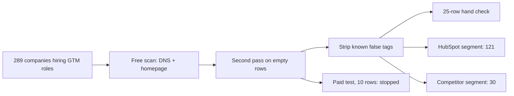

# Tech stack segment: finished

**How I know it works:** the free scanner found a stack for **276 of 289** companies (95.5%). On 25 random rows I checked by hand, it was right on 13, missed a tool on 6, named a wrong tool on 2, and on 4 I couldn't confirm it either way. Total spend: **$0.09**.

Built with: Python, techsight-cli, dig, curl_cffi, treg (Tomba)

**The problem:** "Which of these accounts run HubSpot, and which run Salesforce?" A list without that answer gets one generic message.

**What I built**
1. A list of 289 US companies with 2 to 200 people, each with a sales or marketing job posted on its own hiring page in October. A company hiring for go-to-market this month is growing.
2. A free scan of every domain's DNS records and homepage code, then a second pass on the rows that came back empty.
3. A 25-row random hand check: pull the raw records and HTML for each row and judge every tool the scanner named.
4. Two segments: HubSpot with no competitor CRM (121), and Salesforce or Zoho with no HubSpot (30).
5. A 10-row paid test on the 12 empty rows before buying any more.

**The map**

**What broke**
- The scanner tagged "Apple iCloud Mail" on 74 rows, and none of them were real: the rule matched any Apple verification record. I stripped it.
- Half the Salesforce hits (61 of 122) rested on a guess: that `<company>.my.salesforce.com` exists. I checked all 61, confirmed 2 through the company's own sign-in page, and kept the other 59 out of the segment.
- Running 200 workers at once silently dropped DNS answers. At 50 workers HubSpot showed up on 123 domains instead of 109.
- The paid lookup returned the same canned WordPress stack for 4 unrelated companies. I stopped after 10 rows ($0.089) and didn't pay for the rest.

**What I'd do with more time:** test a paid source that returns its evidence (PredictLeads) on the same 10 rows, and send the three fingerprint bugs upstream.

**Try it:** [the project](https://github.com/Trav54219/gtm-engineering-portfolio/tree/main/projects/03-tech-stack-segment), and [RUN.md](https://github.com/Trav54219/gtm-engineering-portfolio/blob/main/projects/03-tech-stack-segment/RUN.md) reruns the hand check on 3 domains in under 5 minutes.
