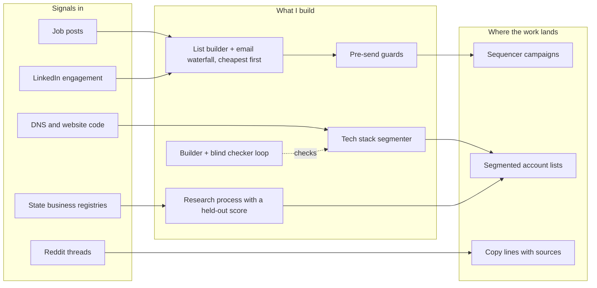

# I'm a GTM engineer. I build list and research systems that check their own work, for B2B teams that sell on contracts.

Software engineer at Fidelity first, then I started an outbound agency and ran it end to end.

**What I want:** a GTM engineer role, full-time or contract, remote (US).

<a href="mailto:HeurtelouTravis@gmail.com">HeurtelouTravis@gmail.com</a> · <a href="https://www.linkedin.com/in/travis-heurtelou/">LinkedIn</a> · <a href="https://github.com/Trav54219">GitHub</a>

## Numbers I can show you how I got

- **22 placements in 55 days** for a UK recruitment agency, from outreach triggered by open job posts. Lead conversion rose 50% over their manual process.
- **48 of 48 merges right** in a HubSpot cleanup graded against an answer key, including 6 same-name decoys left unmerged. 286 contacts scored and routed.
- **18 accounts from 20 job posts**, scored, routed and drafted in HubSpot by a play that runs every morning without me. Software companies the seller excludes scored 0.
- **276 of 289** companies' tech stacks found with a free scanner, then 25 rows checked by hand: 13 right, 6 missed a tool, 2 wrong, 4 unconfirmed.
- **4.33 to 4.67 out of 5:** a builder agent's work, re-scored after a second agent that never saw its notes found four gaps.
- **0 wrong names** on a held-out test of an owner-research process (2 of 4 found; the other 2 honestly answered "not enough evidence").
- **309 sending accounts** moved to new infrastructure after a blocklist listing, re-attached to 37 campaigns with no mismatches.

## Walkthrough

Two-minute screen recording of the tech-stack project: **not recorded yet.**

## Projects

| Project | One line | Status |
|---|---|---|
| [Job-post signal outbound](case-studies/job-signal-outbound.md) | Triggered outreach to hiring managers off open job posts for a UK recruitment agency: 22 placements in 55 days, lead conversion up 50%. | finished, client result |
| [Signal to CRM, on a schedule](case-studies/signal-to-crm.md) | Every morning, new SDR and BDR job posts become scored, routed HubSpot accounts with a contact title and a drafted opener. First run: 18 accounts for 20 credits. | running daily |
| [CRM cleanup, scoring and routing](case-studies/crm-cleanup.md) | Deduplicated, scored and routed a messy HubSpot CRM, with every merge graded against an answer key: 48 right, 0 wrong. | finished |
| [Tech stack segment](case-studies/tech-stack-segment.md) | Found the CRM behind 289 growing companies for free, checked 25 by hand, and split them into a HubSpot segment and a competitor segment. | finished |
| [Agent loop that checks itself](case-studies/agent-loop.md) | One agent builds, a second grades it blind against a written rubric, and I approve the plan and the ship separately. | finished |
| [Owner research process](https://github.com/Trav54219/gtm-engineering-portfolio/tree/main/projects/01-local-owner-research) | Finds the owner of a local service business, scored against answers I wrote down first. | finished, not yet approved for use: misses on tiny businesses |

Also built: a [warm leads list](https://github.com/Trav54219/gtm-engineering-portfolio/tree/main/projects/02-warm-leads-list) from one competitor's LinkedIn audience ($0.38, 2 verified emails) and a [buyer language brief](https://github.com/Trav54219/gtm-engineering-portfolio/tree/main/projects/04-buyer-language-brief) from Reddit (19 verbatim phrases, five sourced copy lines).

## How the pieces fit

## Tools I've built with

Python, Claude Code (agents, skills, hooks), HubSpot CRM API, Smartlead API, treg, Apify, TheirStack, techsight-cli, reddit-find, OpenAI API, MillionVerifier, DeBounce, Next.js, Convex, git and GitHub.

## Career

**Breezy Growth, GTM engineer and founder** (Sep 2024 to now, remote)
- Run outbound end to end: niche, list, verification, copy and a sending fleet of 225 inboxes on 75 domains.
- Wrote 9 pre-send guard scripts that block a launch, a lead add or a spend when something is wrong. [The code](https://github.com/Trav54219/gtm-engineering-portfolio/tree/main/guards).
- Led the recovery when the fleet's shared domain hit a blocklist: 309 accounts replaced, 37 campaigns re-attached. [The write-up](https://github.com/Trav54219/gtm-engineering-portfolio/blob/main/deliverability/incident-blacklisted-main-domain.md).
- Keep a public scoreboard with the bad numbers too: 13 campaigns, 926 contacted, 7 raw replies. [The scoreboard](https://github.com/Trav54219/gtm-engineering-portfolio/blob/main/campaigns/scoreboard.md).
- Built the client portal (Next.js, Convex) that runs campaigns, replies and reporting.

**Fidelity Investments, associate software engineer** (Jun 2023 to Sep 2024, Durham, NC)
- Shipped features for the Fidelity Wallet app on a 12-person agile team.
- Led the move to one grid layout across every screen.
