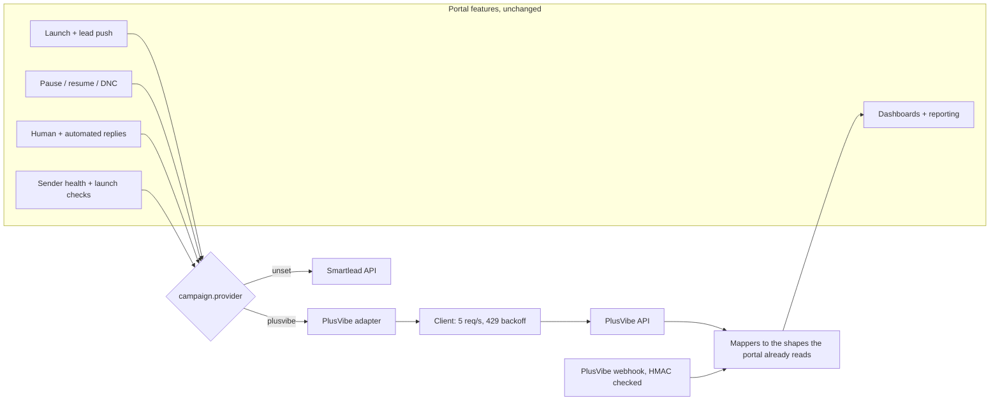

# 08: Moving a production outbound system to a second sequencer

My client portal ran every campaign on Smartlead. That covered launches, lead pushes, pauses, copy, settings, replies, auto-replies, sender health and reporting. I'm moving sending to PlusVibe. The work was to add PlusVibe under all of that without rewriting the portal and without breaking a live Smartlead campaign.

**Status, stated plainly:** merged to production across 6 pull requests, **123 tests passing**, and **switched off**. It has never made a live PlusVibe call, because the API key comes with the Business plan, which gets bought in late November. Every response shape was built from PlusVibe's OpenAPI pages and help center, saved locally, and tested against fixtures. The first live run is the real test, and the turn-on doc lists what to check.

The portal is a private repo (Next.js and Convex, TypeScript), so this write-up quotes the code instead of linking it.

## Size

| | Lines |
|---|---|
| Integration code (`convex/plusvibe/`, webhook route, signing) | about 4,150 |
| Tests (9 files) | about 2,180 |
| Turn-on and mapping doc | 244 |

## How it fits in



A campaign belongs to exactly one sequencer. `campaign.provider = "plusvibe"` routes it through the adapter, and every other campaign keeps its Smartlead path byte for byte. Dashboards, margins and lane economics read the same tables as before, so none of them changed.

## The parts worth reading

**1. Copy translation that refuses instead of guessing.** Portal copy is written in Smartlead syntax. Sent to PlusVibe unchanged, `{Hi|Hey}` would arrive in a prospect's inbox as literal braces. The translator rewrites spintax, fallbacks, custom fields and sender tags. PlusVibe allows one variable per spin block. When a Smartlead option has two, the translator reports it, and the sync refuses to send. Fixing that is a wording choice for a person, not something to rewrite silently.

```ts
//   {a|b|c}            -> {{random|a|b|c}}
//   {{var|default}}    -> {{fallback|{{var}}|default}}
//   {{title}} (custom) -> {{custom_title}}
//   %signature%        -> {{sender_signature}}
for (const o of options) {
  if (varCount(o) > 1) {
    problems.push(`Spin option "${o}" has ${varCount(o)} variables; PlusVibe allows one per block.`);
  }
}
```

**2. A failed reply send is never blindly resent.** A reply that goes out twice is worse than one that goes out late. Smartlead once sent the same reply 5 times through a retry loop, and that's where this rule came from. Every PlusVibe failure is classified. A 4xx means PlusVibe refused and nothing went out, so a retry is safe. No response, a 408 or a 5xx means it may have been queued, so the claim is held and a person decides.

```ts
export function isAmbiguousPlusvibeFailure(e: unknown): boolean {
  if (e instanceof PlusvibeApiError) {
    if (e.status === 0) return true;                    // no response
    if (e.status === 408 || e.status >= 500) return true;
    return false;                                       // a 4xx: PlusVibe refused
  }
  return true;                                          // unknown: assume it may have sent
}
```

**3. One route for every automated sender.** About ten features send replies on their own: the AI auto-reply, nurture, call follow-ups, no-show recovery, reengage, lead magnet and connector intros. They were all written against a Smartlead campaign id. Instead of forking each one, `sequencerRoute(campaign)` returns the Smartlead id unchanged, or `plusvibe:<workspace>:<campaign>`. `replyInThread` sends through either sequencer and throws the same error type. Each feature changed by one call. The live-thread guard reads the PlusVibe thread first, so an automated message never lands on a conversation a person has already answered.

**4. Unhealthy senders block a launch.** An inbox can't send cold mail if PlusVibe reports it as not active, held in recovery, warm-up off, or under 90% seven-day warm-up health. It's named with the reason. An inbox the health read couldn't find doesn't block, so a gap in the data never stops a launch.

**5. Machine replies come out before anything is counted.** Out-of-office, auto-reply, wrong-person and left-company labels go into one bucket before replies are tallied. Every rate is divided by contacted leads, not replies. A row where that split wasn't possible is marked `raw` and isn't quoted as human replies. PlusVibe's own "positive" label goes into the human review queue and is never billed on PlusVibe's say-so.

**6. Dark by default, with two switches.** Reads need the `plusvibe_sync_enabled` flag plus the key. Writes need a separate `plusvibe_control_enabled` flag. Without them, every entry point returns "disabled" and does nothing; none of them throw. The client holds requests to 5 per second, backs off on 429 using `Retry-After` up to 30 seconds, and the webhook checks PlusVibe's HMAC signature and stores one idempotency key per delivery.

## What broke while building it

- **TypeScript went circular.** A Convex action that returns another action's result needs an explicit return type. Without one, `tsc` flagged about 100 implicit-any errors in unrelated files.
- **Codegen needs a deployment.** `convex codegen` can't run without one, so the generated API file was edited by hand to add the new modules. The doc says to rerun codegen once against dev.
- **Some things have no PlusVibe equivalent.** Variant ids, click counts and the bounce split by cause aren't stored the same way. Each gap is listed in the doc instead of being approximated quietly.

## What's left

- The first live run, once the key exists, following the turn-on checklist.
- Forwarding, label sync, inbox attach, and the writes on the mailbox side: warm-up mode, limits, reconnect.
